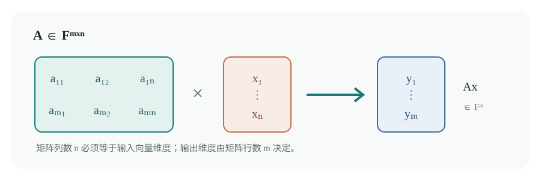

# 数值线性代数的语言：向量、矩阵与记号

> 先读懂对象的形状，再讨论算法的正确性。

一个矩阵算法出错，常常不是因为公式太难，而是因为输入、输出和运算对象的形状没有说清楚。本篇建立后续课程共用的记号：标量、向量、矩阵、维度、转置、共轭转置、逐元素运算与范数。

## 学习目标

- 能从 A∈F^{m×n} 判断矩阵乘法的输入和输出维度。
- 区分转置、共轭转置、逐元素绝对值与向量/矩阵范数。
- 理解实数域与复数域下记号的差异。

*矩阵 A 的 m 行 n 列结构决定了它能作用于 n 维列向量，并产生 m 维结果。行、列和元素索引不是装饰，而是运算契约。*

## 1. 先看维度：每个乘法都要对上形状

在数值线性代数中，矩阵不是一张装数字的表，而是一个把输入向量映射为输出向量的线性变换。若 A 有 m 行、n 列，写作 A∈F^{m×n}；这里 F 通常是实数域 R 或复数域 C。列向量 x∈F^n 经过 A 作用后得到 Ax∈F^m。

维度检查可以在计算之前排除一类错误：A∈R^{m×n} 不能直接右乘一个长度不是 n 的列向量；若要计算 A B，则 A 的列数必须等于 B 的行数。矩阵乘法的输出形状由外侧维度决定。

数值程序里常见的形状约定是：向量默认按列向量理解；一个矩阵的第 i 行、第 j 列元素写作 aᵢⱼ；A(i:j,k:l) 表示从第 i 到 j 行、第 k 到 l 列截取的子矩阵。实际 Python 切片通常从 0 开始，而数学索引通常从 1 开始，二者必须明确区分。

$$
A\in\mathbb{F}^{m\times n},\quad x\in\mathbb{F}^{n},\quad Ax\in\mathbb{F}^{m}.
$$

来源定位：[Demmel, §1.1](https://doi.org/10.1137/1.9781611971446)。

## 2. 转置、共轭转置与逐元素运算

实矩阵的转置 Aᵀ 交换行和列，满足 (Aᵀ)ᵢⱼ=aⱼᵢ。复矩阵还需要共轭转置 A*=\overline{A}ᵀ：先转置，再对每个元素取复共轭。对实矩阵，A*=Aᵀ；对复矩阵，两者通常不同。

逐元素绝对值 |A| 的第 i,j 个元素是 |aᵢⱼ|。它不是矩阵范数。类似地，|x| 是逐元素取绝对值后的向量。若写 |A|≤|B|，这里表示每个对应元素都满足不等式，而不是比较两个矩阵的大小。

单位矩阵 I 满足 Ix=x；共轭转置还定义了复向量的内积 x*y。复数场景下，若把转置误写成共轭转置，或者反过来，可能改变正交性、能量和投影的含义。

## 3. 范数回答的是“误差有多大”

向量范数把向量映射为非负长度。常见的 1-范数、2-范数和无穷范数分别衡量绝对值之和、欧几里得长度和最大分量。矩阵范数衡量矩阵整体大小；诱导范数则描述矩阵对向量长度的最大放大倍数。

Frobenius 范数是所有矩阵元素平方和的平方根，便于计算；它与谱范数不同。谱范数等于最大奇异值，描述矩阵对 2-范数的最大放大。后续讨论条件数时，必须说清使用哪一种范数，因为条件数的数值依赖范数选择。

不要把逐元素绝对值、向量范数和矩阵范数混为一谈：|A|仍然是一个矩阵；||x|| 是一个标量；||A|| 也是一个标量，但其定义取决于选定的矩阵范数。

## 4. 用一个维度检查完成第一次推导

设 A 是 2×3 矩阵，x 是 3 维列向量。Ax 的两个分量分别是 A 每一行与 x 的内积，所以结果是 2 维向量。若把 x 写成 2 维，乘法在定义层面就不成立，不需要运行程序才知道错误。

在复数计算中，若 A 是 2×3 复矩阵，A* 的形状是 3×2；x*y 是标量，而 xᵀy 不一定是复内积。这个小例子把维度和共轭约定同时固定下来。

## 动手检查

交互检查：一个矩阵元素究竟在哪里？

选择矩阵 A 的元素，观察行索引、列索引和子矩阵记号。

1. **a12**：a₁₂ 位于第 1 行、第 2 列；A(1:2, 2:3) 会包含它。
2. **a23**：a₂₃ 位于第 2 行、第 3 列；它只在列数至少为 3 时存在。
3. **a31**：a₃₁ 位于第 3 行、第 1 列；若 A 只有 2 行，这个索引无效。

## 参考资料

- [James W. Demmel, Applied Numerical Linear Algebra, Chapter 1 §1.1](https://doi.org/10.1137/1.9781611971446)（notation）
