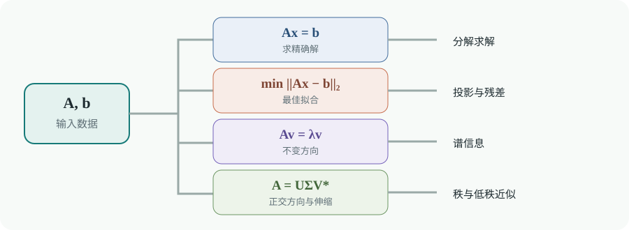

# 数值线性代数究竟要解决哪些问题

> 先辨认问题类型，才能选择正确的数值算法。

同一组矩阵和向量，可以提出完全不同的计算问题：求精确解、拟合数据、找不变方向，或分离最重要的变化模式。它们的数学目标、误差标准和算法都不同。

## 学习目标

- 区分线性系统、最小二乘、特征值与奇异值问题。
- 理解过定、欠定、秩亏与广义特征值问题。
- 知道矩阵结构会改变算法选择。

*四类核心任务共享矩阵表示，却优化不同的对象：线性系统找解，最小二乘找最佳拟合，特征值找不变方向，SVD 找正交坐标下的伸缩强度。*

## 1. 线性系统：找到让方程成立的 x

线性系统 Ax=b 给定系数矩阵 A 和右端项 b，要求找到 x 使等式成立。若 A 是 n×n 非奇异矩阵，解唯一；若 A 奇异，可能无解，也可能有无穷多解。实际计算关注的不是显式构造 A⁻¹，而是用分解和三角求解得到 x。

线性系统来自电路方程、结构力学离散、网格 PDE、网络流和参数估计。模型规模可以从几十维增长到数百万维；矩阵可能稠密，也可能只有少量非零元素。矩阵结构决定存储与算法。

## 2. 最小二乘：当方程无法同时精确满足

当观测方程多于未知量时，Ax=b 通常没有精确解。最小二乘问题改为寻找 x，使残差 r=Ax−b 的 2-范数最小。几何上，Ax 落在 A 的列空间中；最小二乘解让 b 到这个列空间的距离最短。

当方程少于未知量时，系统通常有多个解。若需要唯一结果，还要增加最小范数、正则化或其他约束。若 A 列秩亏，最小二乘解也可能不唯一；SVD 或带列主元的 QR 能显式揭示有效秩。

$$
\min_{x\in\mathbb{R}^n}\|Ax-b\|_2,\qquad r=Ax-b.
$$

## 3. 特征值与奇异值：矩阵如何改变方向和长度

特征值问题寻找非零向量 v，使 Av=λv。沿 v 方向，矩阵作用只改变尺度（可能也改变符号或相位），不改变方向。对非对称矩阵，特征值可能是复数，特征向量也可能高度敏感。

对任意 m×n 矩阵 A，奇异值是 A*A 的特征值的非负平方根。SVD 写作 A=UΣV*，把输入空间的正交方向、非负伸缩量和输出空间的正交方向分开。奇异值可用于秩、条件数、低秩近似和最小二乘分析。

## 4. 结构与问题类型共同决定算法

对称正定矩阵适合 Cholesky；一般方阵可用带选主元的 LU；满列秩最小二乘常用 Householder QR；需要揭示秩或处理强病态问题时，SVD 更有信息。大型稀疏系统则可能使用预条件 Krylov 子空间方法。

一个可靠的求解流程先问：目标是精确解、最佳拟合还是谱信息？矩阵是否对称、正定、稀疏、带状或低秩？需要多高精度？这些问题比“哪个算法最快”更先决定方案。

## 动手检查

交互检查：选择你真正要解的问题

切换任务，观察同一矩阵记号背后的目标如何变化。

1. **solve**：线性系统：求 x，使 Ax=b；报告残差 ||Ax−b||。
2. **least**：最小二乘：求 x，使 ||Ax−b||₂ 最小；报告残差和拟合质量。
3. **eigen**：特征值：求 Av=λv；报告特征残差 ||Av−λv||。
4. **svd**：奇异值：求 A=UΣV*；检查重构误差 ||A−UΣV*||。

## 参考资料

- [James W. Demmel, Applied Numerical Linear Algebra, Chapter 1 §1.2](https://doi.org/10.1137/1.9781611971446)（problem taxonomy）
- [LAPACK project overview](https://netlib.org/lapack/)（supported problem families）
