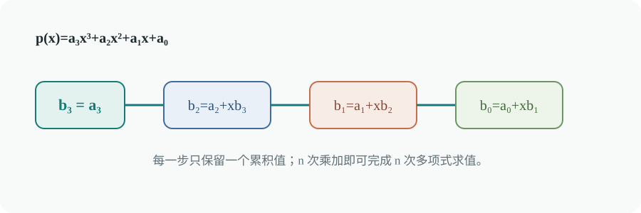

# 多项式求值：Horner 方法与数值稳定性

> 一个短小的计算任务，揭示运算次数、条件数与舍入误差之间的关系。

多项式看起来只是若干次幂和系数的加权和，但直接计算会重复形成幂次，并可能发生严重消去。Horner 方法把多项式改写成嵌套形式，用线性数量的乘加完成求值；它的误差仍受问题条件数影响。

## 学习目标

- 推导 Horner 递推并计算运算次数。
- 正确计算多项式求值的相对条件数。
- 理解算法稳定性不能消除问题本身的病态性。

*Horner 递推从最高次系数开始，逐层乘以 x 并加上下一个系数。每一步只保留一个累积值，避免显式构造所有幂次。*

## 1. 从幂次和到嵌套形式

设 p(x)=aₙxⁿ+aₙ₋₁xⁿ⁻¹+…+a₁x+a₀。直接求值可以分别计算各个 x 的幂，再乘系数并求和；但许多幂次会被重复计算，且中间数值可能很大。

Horner 方法把表达式重写为 a₀+x(a₁+x(a₂+…+x aₙ))。从最高次系数开始递推：bₙ=aₙ，bₖ=aₖ+x bₖ₊₁，最终 p(x)=b₀。对 n 次多项式，需要 n 次乘法和 n 次加法；支持 fused multiply-add 的硬件可把每层乘加合并为一次舍入操作。

$$
b_n=a_n,\qquad b_k=a_k+x\,b_{k+1}\quad(k=n-1,\ldots,0),\qquad p(x)=b_0.
$$

## 2. 算法稳定，但问题可能病态

对系数按降幂排列的多项式，常用相对条件数为 κₚ(x)=Σₖ|aₖ||x|ᵏ/|p(x)|。分子衡量各项绝对值之和，分母是实际结果。若不同项彼此抵消，使 p(x) 很小，条件数就会很大。

Horner 方法在标准浮点模型和正常数范围等假设下，对系数扰动具有良好的后向误差性质；常见前向误差界会包含 γ₂ₙ Σ|aₖ||x|ᵏ。把它除以 |p(x)| 后，条件数自然出现。算法稳定并不意味着相对误差一定小：当 κₚ(x) 很大时，输入系数或舍入误差仍可能导致较大相对输出误差。

$$
\kappa_p(x)=\frac{\sum_{k=0}^{n}|a_k|\,|x|^k}{|p(x)|}.
$$

## 3. 一个接近根的例子

考虑 p(x)=x²−2x+1=(x−1)²。当 x 接近 1 时，三个项 x²、−2x、1 的大小都接近 1，但相加后的结果接近 0。分子仍接近 4，分母却趋近 0，因此条件数迅速增大。

这不是 Horner 独有的缺陷：在根附近，问题本身就对系数相对扰动敏感。此时应关注绝对误差、根的位置误差或区间保证，而不是只盯着相对函数值误差。

## 4. 二分法需要一个真正的括区间

若要找连续函数的根，二分法要求区间 [a,b] 两端异号，或某个端点已经是根。每次取中点并保留仍然括住根的半区间；区间长度每步减半。停止条件应基于区间宽度或函数值容差。

只检查迭代次数而不检查括区间是不可靠的：若端点同号，算法可能收敛到一个没有根的端点附近。当前代码明确验证区间顺序、正容差、端点根和符号变化；空系数、非有限值和无效输入也必须显式拒绝。

## 动手检查

交互检查：Horner 递推逐步累积

对 p(x)=2x³−6x²+2x−1，选择求值点，观察 Horner 的最终值。

1. **1**：x=1：p(1)=−3。Horner 累积为 2 → −4 → −2 → −3。
2. **2**：x=2：p(2)=−5。Horner 累积为 2 → −2 → −2 → −5。
3. **3**：x=3：p(3)=5。Horner 累积为 2 → 0 → 2 → 5。

## 参考资料

- [James W. Demmel, Applied Numerical Linear Algebra, Chapter 1 §1.4](https://doi.org/10.1137/1.9781611971446)（polynomial evaluation）
- [Nicholas J. Higham, Accuracy and Stability of Numerical Algorithms, 2nd ed.](https://doi.org/10.1137/1.9780898718027)（floating-point error analysis）
