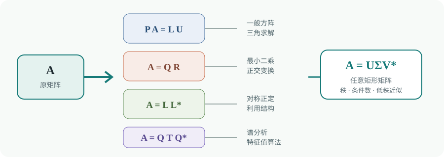

# 为什么要把矩阵分解成更简单的矩阵

> 分解不是改写符号，而是把难问题变成可计算的子问题。

求解 Ax=b 时，直接求逆通常不是最好的计算路径。矩阵分解把一个复杂矩阵表示为结构简单、容易求解或容易分析的因子。不同分解适用于不同结构和目标，不能互相替代。

## 学习目标

- 理解带主元 LU、QR、Cholesky、Schur 和 SVD 的适用条件。
- 知道正交变换为何有利于误差控制。
- 能根据问题类型选择分解，而不是一律求逆。

*矩阵分解把一次复杂运算拆成结构化步骤：置换与三角求解、正交变换、正定结构或正交奇异方向。*

## 1. LU：把一般线性系统变成两次三角求解

高斯消去通过消去主元列下面的元素，把 A 变成上三角矩阵 U；消去过程中使用的乘子组成下三角矩阵 L。实际计算通常需要行置换，因此关系写成 P A=L U，而不是无条件写 A=LU。

求解 Ax=b 时，先求 Ly=Pb，再求 Ux=y。三角系统可用前代和回代高效求解。部分选主元通过交换当前列中绝对值较大的候选主元到对角位置，避免除以过小元素；它显著改善实践稳定性，但不意味着所有矩阵都没有误差放大。

来源定位：[Demmel, §1.3.1](https://doi.org/10.1137/1.9781611971446)；[LAPACK](https://netlib.org/lapack/)。

## 2. QR：用正交变换处理最小二乘

QR 分解把 A 写成 Q R，其中 Q 的列正交归一，R 为上三角矩阵。对满列秩 m×n 矩阵（m≥n），经济型 QR 中 Q 为 m×n，R 为 n×n。Householder 反射是稳定且常用的构造方式。

对最小二乘问题，必须区分完整 QR 与经济型 QR。完整分解可写为 A=Q₁R，其中 Q=[Q₁ Q₂] 是 m×m 酉矩阵；因为 Q* 保持 2-范数，有 ||Ax−b||₂²=||Rx−Q₁*b||₂²+||Q₂*b||₂²，最小值由求解 R x=Q₁*b 得到。若只存经济型 Q₁（m×n），不能声称 Q₁* 在整个 m 维空间上保范数；残差还包含正交补分量 Q₂*b。

## 3. Cholesky：利用对称正定结构

若 A 是实对称正定矩阵，存在唯一对角元素为正的下三角 L，使 A=LLᵀ。复 Hermitian 正定矩阵则写 A=LL*。Cholesky 比一般 LU 更省算术，也利用了对称结构；若矩阵不正定，分解会失败，不能强行套用。

正定性通常来自能量、协方差或严格凸二次型。算法实现仍需检查矩阵是否对称/Hermitian、数值尺度是否合理，以及舍入误差是否让理论正定矩阵在计算中接近失去正定性。

## 4. Schur 与 SVD：谱信息和任意矩形矩阵

Schur 分解对任意复方阵给出 A=Q T Q*，其中 Q 酉、T 上三角；实数情形的 T 通常是准上三角块结构。它比直接追求特征向量矩阵更稳健，是许多特征值算法的基础。

SVD 对任意 m×n 矩阵成立：A=UΣV*。U、V 的列向量正交，Σ 的对角线上是非负奇异值。截断 SVD 可以构造低秩近似；最小奇异值与最大奇异值之比也揭示矩阵对不同方向的伸缩差异。

$$
PA=LU,\quad A=QR,\quad A=LL^*,\quad A=Q T Q^*,\quad A=U\Sigma V^*.
$$

## 5. 选择分解时先写清假设

一般稠密方阵求解：优先考虑带部分选主元的 LU。满列秩最小二乘：通常使用 Householder QR。对称正定系统：考虑 Cholesky。需要可靠秩信息、伪逆或最优低秩近似：使用 SVD。研究特征值：Schur 形式往往比直接形成特征向量矩阵更稳妥。

分解的名字并不自动保证数值正确。要检查重构残差、正交性、三角结构和输入矩阵假设；还要区分完整分解与经济型分解，以及实数和复数版本。

## 动手检查

交互检查：哪一种分解符合当前结构？

选择矩阵结构，查看应优先考虑的分解与前提。

1. **general**：一般稠密方阵：带部分选主元 LU，PA=LU。
2. **least**：满列秩最小二乘：Householder QR，避免显式形成 A*A。
3. **spd**：对称正定矩阵：Cholesky，A=LL*。
4. **rank**：秩不确定或需要最佳低秩近似：SVD，A=UΣV*。

## 参考资料

- [James W. Demmel, Applied Numerical Linear Algebra, Chapter 1 §1.3.1](https://doi.org/10.1137/1.9781611971446)（factorization overview）
- [LAPACK project overview](https://netlib.org/lapack/)（LU, QR, Cholesky, Schur and SVD routines）
