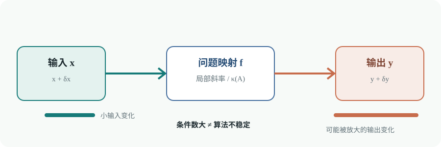

# 输入误差如何放大：扰动理论与条件数

> 先判断问题是否敏感，再评价算法是否稳定。

测量数据、模型参数和上游计算都不可能无限精确。条件数描述输入发生微小变化时，正确答案可能改变多少；它描述问题本身的敏感程度，不是某个算法的速度或质量评分。

## 学习目标

- 区分绝对条件数与相对条件数。
- 推导线性系统对 A、b 扰动的一阶误差界。
- 区分问题病态与算法不稳定。

*输入扰动经过问题映射后可能被放大。条件数刻画这种放大能力；算法稳定性则另行衡量计算过程引入的误差。*

## 1. 从一元函数看条件数

设要计算 y=f(x)，但输入只知道 x+δx。若 f 在 x 附近可微，一阶近似给出 δy≈f'(x)δx。绝对条件数 |f'(x)| 衡量输入绝对误差对输出绝对误差的影响。

若输入和输出都用相对误差衡量，则局部相对条件数为 |x f'(x)/f(x)|（要求 x 与 f(x) 非零）。它表示输入相对变化 1% 时，输出相对变化大约会达到多少倍。条件数依赖问题的尺度和误差度量。

$$
\kappa_{\mathrm{rel}}(x)=\left|\frac{x f'(x)}{f(x)}\right|.
$$

来源定位：[Demmel, §1.3.2](https://doi.org/10.1137/1.9781611971446)；[Higham, Accuracy and Stability](https://doi.org/10.1137/1.9780898718027)。

## 2. 线性系统的条件数

对非奇异线性系统 Ax=b，矩阵条件数定义为 κ(A)=||A||·||A⁻¹||，范数必须前后一致。κ(A)≥1；κ(A) 越大，系统对相对输入扰动越敏感。2-范数条件数等于最大奇异值与最小奇异值之比。

若 A 固定而 b 改变，一阶相对误差界约为 ||δx||/||x||≤κ(A)||δb||/||b||。如果 A 与 b 都变化，在 κ(A)||δA||/||A||<1 的条件下，可以得到含分母 1−κ(A)||δA||/||A|| 的扰动上界。该界说明：矩阵本身的扰动也可能放大解误差。

$$
\kappa(A)=\|A\|\,\|A^{-1}\|,\qquad \frac{\|\delta x\|}{\|x\|}\lesssim \kappa(A)\left(\frac{\|\delta A\|}{\|A\|}+\frac{\|\delta b\|}{\|b\|}\right).
$$

## 3. 病态问题不等于算法写错

病态是问题本身对输入敏感；算法不稳定是计算过程把误差额外放大。一个稳定算法求解病态问题，仍可能得到相对误差较大的答案，因为输入本身的微小变化就足以改变正确解。相反，良态问题也可能被不稳定算法算坏。

例如两列几乎平行的矩阵，其最小奇异值很小，条件数很大。微小观测噪声就可能让解沿近似零空间方向大幅变化。换成更稳定的 QR 或 SVD 能避免额外的算法误差，却不能凭空恢复输入中不存在的信息。

## 4. 实际诊断顺序

先估计条件数，再检查残差和后向误差，最后结合模型误差判断解是否可信。若条件数很大，考虑重新缩放、增加观测、正则化或改变模型；若条件数适中但残差/后向误差很大，则要检查算法、实现、精度和数据路径。

条件数不是误差的精确预测。它给出局部敏感性尺度，实际误差还取决于扰动方向、数据分布和问题结构。不要只报告一个 κ 数值而不说明范数、尺度和计算目标。

## 动手检查

交互检查：同样的输入误差会被放大多少？

选择条件数 κ，观察输入相对误差 10⁻⁶ 对输出的线性化影响。

1. **1**：κ=1：输出相对误差约 10⁻⁶，问题在该尺度下不放大误差。
2. **100**：κ=100：输出相对误差约 10⁻⁴，输入误差被放大约 100 倍。
3. **100000**：κ=100000：线性化估计约 10⁻¹，结果对输入扰动非常敏感。

## 参考资料

- [James W. Demmel, Applied Numerical Linear Algebra, Chapter 1 §1.3.2](https://doi.org/10.1137/1.9781611971446)（conditioning）
- [Nicholas J. Higham, Accuracy and Stability of Numerical Algorithms, 2nd ed.](https://doi.org/10.1137/1.9780898718027)（condition and stability analysis）
