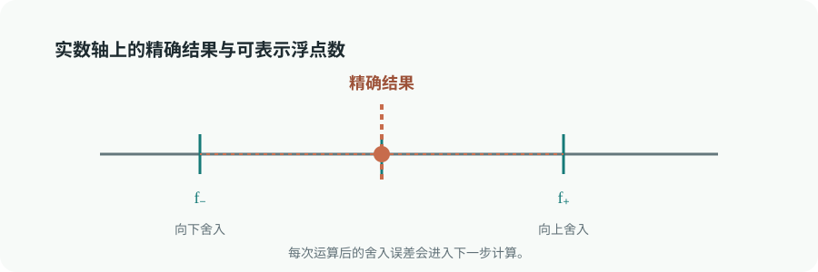

# 计算机为什么会算错：舍入误差与稳定性

> 计算机执行的是有限精度运算，不是实数算术。

在纸面上等价的表达式，在浮点数中可能给出不同结果。理解舍入误差，关键不是记住机器精度，而是弄清误差如何进入算法、如何传播，以及算法能否把结果解释为邻近问题的精确解。

## 学习目标

- 理解标准浮点误差模型和 unit roundoff。
- 识别消去、溢出、下溢与非结合性。
- 区分向前误差、向后误差和数值稳定性。

*浮点运算先把精确结果舍入到可表示数。后续运算会继续传播这些微小偏差；运算顺序和消去现象会改变最终误差。*

## 1. 浮点数只表示有限集合中的数

实数轴上有无穷多个数，有限位存储只能表示有限多个浮点数。二进制浮点数通常由符号、有效数和指数构成；无法精确表示的结果必须按某种舍入规则映射到邻近可表示数。IEEE 754 规定了常见二进制/十进制格式、舍入和异常行为。

对正常范围内、没有溢出或下溢的基本运算，常用模型是 fl(a op b)=(a op b)(1+δ)，其中 |δ|≤u，u 为 unit roundoff。对 binary64，精度 p=53，round-to-nearest 下 u=2⁻⁵³；它与 1 之后相邻浮点数间距 2⁻⁵²（常被称作 machine epsilon）不是同一个量。

$$
\operatorname{fl}(a\circ b)=(a\circ b)(1+\delta),\qquad |\delta|\le u.
$$

## 2. 消去与运算顺序

灾难性消去发生在两个接近的数相减时：高位有效数字抵消，结果的相对误差可能显著增大。即使每一步运算都正确舍入，表达式的数学条件数也可能很大。

浮点加法不满足实数算术中的结合律。例如 binary64 中，先计算 (10¹⁶−10¹⁶)+1 得到 1；先计算 10¹⁶+(−10¹⁶+1)，括号内的 −10¹⁶+1 会舍入回 −10¹⁶，最终得到 0。改变运算顺序，结果就不同。

溢出会产生无穷大，下溢可能进入次正规数或舍入为零；NaN 表示未定义数值结果。算法必须明确处理这些情况，不能把“程序没有崩溃”当成数值正确。

## 3. 向前误差与向后误差

向前误差比较计算结果与真实答案，例如 ||x̂−x||。向后误差则问：x̂ 是否是一个略微扰动后的输入问题的精确解？对线性系统，可检查是否存在小的 ΔA、Δb，使 (A+ΔA)x̂=b+Δb。

向后稳定算法的计算结果可解释为邻近问题的精确解。若问题本身条件良好，向后误差小通常意味着向前误差也小；若问题病态，即使后向误差很小，向前误差仍可能很大。这把本篇与条件数连接起来。

在标准模型下，n 次舍入误差常用 γₙ=nu/(1−nu) 表示累计上界（要求 nu<1，并满足模型假设）。它不是对任意程序都成立的 O(nu) 保证；具体界限还取决于运算图、符号抵消和中间结果范围。

## 4. 怎样让计算更可信

选择具有稳定性分析的算法，避免显式求逆和不必要的相减；对求和可使用补偿求和，对最小二乘优先考虑正交变换而不是直接形成正规方程；对线性系统同时报告残差、后向误差和条件数。

所有数值结论都要注明精度、数据范围、舍入假设和是否可能溢出/下溢。高精度运算可以降低舍入误差，却不会自动修复病态问题、错误模型或不合理的算法。

## 动手检查

交互检查：只改变加法顺序

两种表达式在实数中相等，但 binary64 的舍入使结果不同。

1. **left**：先算 (10¹⁶ + −10¹⁶) + 1：中间结果为 0，最终结果为 1。
2. **right**：先算 10¹⁶ + (−10¹⁶ + 1)：括号内先舍入，最终结果为 0。

## 参考资料

- [IEEE Std 754-2019, IEEE Standard for Floating-Point Arithmetic](https://standards.ieee.org/ieee/754/6210/)（formats, rounding and exceptions）
- [David Goldberg, What Every Computer Scientist Should Know About Floating-Point Arithmetic, ACM Computing Surveys 23(1), 1991](https://doi.org/10.1145/103162.103163)（rounding and cancellation）
- [James W. Demmel, Applied Numerical Linear Algebra, Chapter 1 §1.3.3](https://doi.org/10.1137/1.9781611971446)（roundoff effects）
