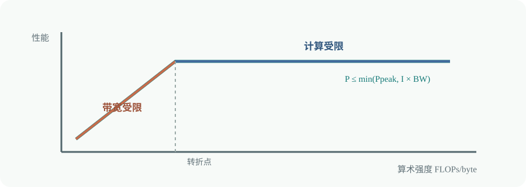

# 为什么 FLOPs 少不一定跑得快

> 算术次数只是性能的一部分；数据移动也要付费。

两个算法完成相同数学任务，理论浮点运算次数更少的那个，未必在真实机器上更快。现代处理器有多级缓存、并行执行单元和不同带宽的数据路径；算法如何访问数据，往往和它做多少次乘加同样重要。

## 学习目标

- 区分渐近复杂度、FLOPs 与实测运行时间。
- 理解缓存、数据移动和算术强度。
- 知道如何设计可复现的性能基准。

*Roofline 模型把算术强度与硬件峰值性能、内存带宽联系起来：低算术强度的内核更可能受内存带宽限制。*

## 1. 先算工作量，再谈运行时间

FLOP 是一次浮点加、减、乘或除等算术操作的计数单位（具体口径要说明）。对 n×n 稠密矩阵乘法，经典算法的主导工作量约为 2n³ FLOPs；渐近复杂度写作 O(n³)。复杂度帮助比较规模增长，但没有包含硬件、内存层级和实现常数。

运行时间测量的是某个实现、某组数据、某台机器和某个软件栈的表现。它受 CPU/GPU 型号、线程数、BLAS 实现、内存布局、缓存状态、系统负载和数据尺寸影响。一次计时不能代表普遍性能。

来源定位：[Demmel, §1.3.4](https://doi.org/10.1137/1.9781611971446)；[Roofline model](https://doi.org/10.1145/1498765.1498785)。

## 2. 数据移动会限制算术吞吐

CPU 读取寄存器中的数据最快，随后是 L1/L2/L3 缓存、主存和更远的存储。若算法反复从较慢层级读取同一数据，处理器可能在等待数据，而不是执行浮点运算。矩阵乘法通过分块把子矩阵留在缓存中重复使用，减少数据往返。

算术强度定义为执行的 FLOPs 除以传输的字节数。算术强度低的算法通常更容易受内存带宽限制；算术强度高的算法则更可能受峰值计算能力限制。Roofline 模型给出上界 P≤min(P_peak, I×BW)，其中 I 是算术强度，BW 是可用内存带宽。

$$
P\le \min(P_{\mathrm{peak}},\,I\cdot BW),\qquad I=\frac{\text{FLOPs}}{\text{bytes moved}}.
$$

## 3. 迭代算法还要计算收敛成本

迭代算法每一步可能很便宜，但需要多少步取决于收敛速度、停止阈值、初始猜测和预条件器。比较算法时，要比较达到同一误差目标的总成本，而不是只比较单步 FLOPs。

例如共轭梯度法适用于对称正定系统；其理论收敛界与条件数相关。好的预条件器可能增加每一步工作量，却显著减少迭代次数。性能分析必须把每步成本与迭代次数合起来。

## 4. 如何做可复现的基准测试

固定输入尺寸、数据类型、线程数和软件版本；预热后重复计时，报告中位数或分位数；分别测量分解、求解和残差计算；使用多组尺寸观察缓存转折点。不要把一次启动开销或后台负载误认为算法差异。

每次优化都要检查数值结果：计算残差、重构误差或正交性；比较相同精度和容差下的时间。更快但不再满足误差要求的程序，不是等价优化。

## 动手检查

交互检查：规模扩大时，矩阵乘法工作量如何增长？

选择矩阵边长 n，观察经典矩阵乘法的主导 FLOPs。

1. **32**：n=32：约 65,536 FLOPs（2n³），小规模可能主要受启动与调度开销影响。
2. **128**：n=128：约 4,194,304 FLOPs（2n³），数据复用开始明显影响效率。
3. **512**：n=512：约 268,435,456 FLOPs（2n³），缓存分块和高性能 BLAS 更重要。

## 参考资料

- [James W. Demmel, Applied Numerical Linear Algebra, Chapter 1 §1.3.4](https://doi.org/10.1137/1.9781611971446)（algorithm speed and data movement）
- [Williams, Waterman & Patterson, Roofline: An Insightful Visual Performance Model for Multicore Architectures, 2009](https://doi.org/10.1145/1498765.1498785)（arithmetic intensity and bandwidth）
