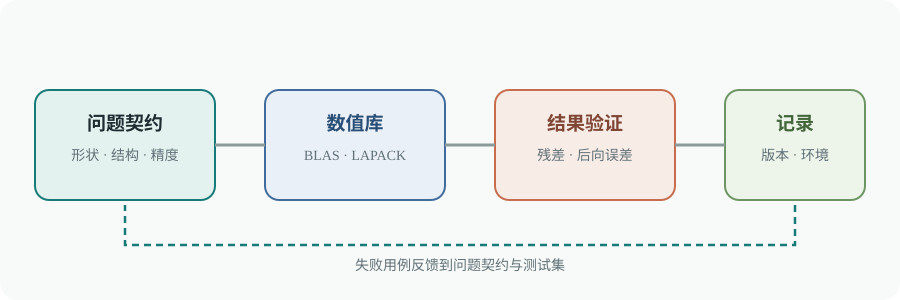

# 如何构建可信的数值计算软件

> 把数学假设、软件接口、测试和性能放在同一张设计图里。

一个数值程序不只需要实现公式。它还要定义输入契约、处理异常数据、选择合适的算法、检查结果质量，并在不同机器和软件版本下保持可复现。工程质量是数值可信度的一部分。

## 学习目标

- 知道何时使用成熟数值库而不是自行实现算法。
- 区分求解接口与显式求逆。
- 建立输入检查、数值验证和可复现报告流程。

*可信数值软件形成闭环：明确问题与输入契约，调用匹配的算法库，验证残差/误差，再记录环境与性能。*

## 1. 软件选择的三个维度

数值软件常在易用性、可靠性和速度之间权衡。成熟库通常经过大量测试和针对硬件的优化；交互式环境适合探索与原型；自定义代码适合研究新算法或表达特殊结构，但需要承担更多测试与维护责任。

选择软件前先描述问题：矩阵大小、稠密/稀疏、对称性、正定性、精度、内存预算、调用次数和目标平台。一个只求解一次的小问题，优先使用成熟接口往往比自己写 LU 更省时也更可靠。

## 2. 让库负责底层数值内核

BLAS 提供向量与矩阵的基础运算，LAPACK 在其上提供线性系统、最小二乘、特征值和奇异值等算法。NumPy 的线性代数接口在可用时依赖 BLAS/LAPACK；SciPy 进一步提供更多分解与矩阵函数。MATLAB 的 A\\b 接口会按矩阵形状和结构选择求解路径。

求解 Ax=b 时，通常使用 solve 或左除接口，而不是先计算 A⁻¹ 再乘 b。显式求逆会计算出一个更大的中间对象，增加工作量和误差传播机会；若目标只是求解线性系统，直接求解接口表达得更准确。

## 3. 把数值检查写进程序契约

输入检查包括形状、数据类型、有限值、矩阵结构和单位/尺度；输出检查包括残差、后向误差、正交性、重构误差或约束违背量。对病态问题，还应估计条件数，并解释误差为何可能被放大。

测试集不应只有随机良态矩阵。还要覆盖零矩阵、奇异矩阵、近奇异矩阵、极端尺度、重复奇异值、复数输入和边界维度。对每个测试，明确预期异常、允许误差和可重复随机种子。

$$
\mathrm{backward\ error}\approx \frac{\|Ax-b\|}{\|A\|\,\|x\|+\|b\|}.
$$

## 4. 记录可复现性与版本

性能结果必须记录硬件、操作系统、Python/MATLAB 版本、BLAS 实现、线程数、数据类型、矩阵规模、随机种子和容差。相同代码在不同 BLAS、不同线程数或不同精度下可能有不同的运行时间和最后几位结果。

数值软件的交付物不仅是函数，还包括 API 契约、错误处理、测试、依赖版本、基准方法和已知限制。对于科学计算，能解释结果为何可信，比单纯给出一个数字更重要。

## 动手检查

交互检查：不同任务应该调用什么工具？

选择实际任务，查看推荐的接口层级。

1. **solve**：稠密方阵 Ax=b：使用 numpy.linalg.solve 或 MATLAB A\\b，并检查残差。
2. **least**：矩形/过定系统：使用 numpy.linalg.lstsq 或 MATLAB A\\b，并检查秩与残差。
3. **large**：大型稀疏系统：使用 scipy.sparse.linalg 的迭代方法，并评估预条件器。
4. **research**：研究新算法：实现最小内核，同时建立参考解、误差测试和基准。

## 参考资料

- [LAPACK project and Users' Guide](https://netlib.org/lapack/)（numerical library scope）
- [NumPy linear algebra documentation](https://numpy.org/doc/stable/reference/routines.linalg.html)（BLAS/LAPACK backend and interfaces）
- [MATLAB systems of linear equations](https://www.mathworks.com/help/matlab/math/systems-of-linear-equations.html)（matrix left division and system types）
- [James W. Demmel, Applied Numerical Linear Algebra, Chapter 1 §1.3.5](https://doi.org/10.1137/1.9781611971446)（numerical software engineering）
