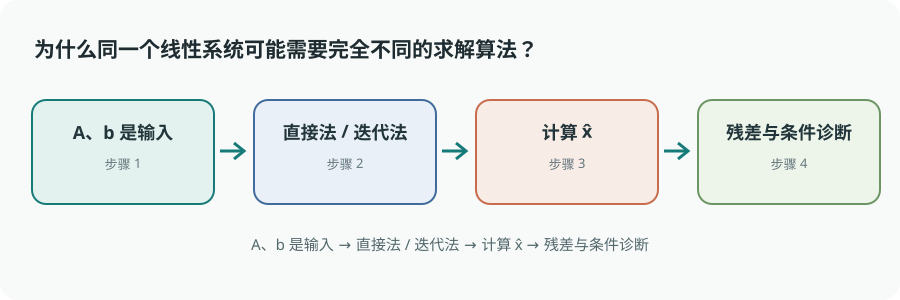

# 从 Ax=b 出发：如何判断一个线性方程组求得是否可靠

> 给出一个解只是开始；残差、条件数与求解成本决定它是否值得信任。

电路、有限元、网络流和最小二乘的中间计算都可能落到方阵线性系统 Ax=b：已知 A∈Rⁿˣⁿ 和 b∈Rⁿ，求 x∈Rⁿ。数学上一个非奇异 A 对应唯一解；在计算机上，求解还涉及精度、存储结构、运算次数和误差诊断。只报告向量 x，远远不够。



*求解并非只输出 x̂：数据、算法、近似解与数值诊断构成闭环。*

## 1. 一个方程组有三份必须区分的对象

输入是矩阵 A 与右端项 b；真实解 x 满足 Ax=b；计算机给出的是近似解 x̂。误差 e=x̂−x 需要知道真实解才能直接计算，但残差 r=b−Ax̂ 只用已知数据即可形成。残差小说明算得的 x̂ 接近满足原方程，并不能单独保证它接近真实解。

若 A 非奇异，关系 e=−A⁻¹r（按 e=x̂−x 的符号约定）解释了残差为什么需要与逆矩阵范数一起判断：A⁻¹ 可以把一个小残差放大成较大的解误差。

## 2. 直接法与迭代法是两条不同计算路线

稠密小型或中型系统通常采用分解：例如带部分选主元的 LU 把 PA=LU，之后先解 Ly=Pb 再解 Ux=y。分解成本约为 (2/3)n³ 次浮点运算，给定分解后每个右端项的三角求解约为 O(n²)。如果 A 不变而 b 变化，复用分解尤其划算。

大型稀疏系统常考虑迭代方法：从 x₀ 开始生成 x₁、x₂…，结合残差和容差判断何时停止。不能说所有迭代方法都适用于所有矩阵；例如共轭梯度要求对称正定，GMRES 可用于更一般的非对称系统。矩阵结构、预条件器和达到目标精度的总工作量共同影响选择。

$$
\eta=\frac{\|b-A\hat x\|_2}{\|A\|_2\|\hat x\|_2+\|b\|_2}
$$

## 3. 先检查结果，再解释误差

对给定的 x̂，计算相对残差 ||b−Ax̂||₂/(||A||₂||x̂||₂+||b||₂)。它常被用作范数型后向误差指标。再估计 κ₂(A)，才有可能评估残差对应的解敏感性。残差与条件数回答不同问题：前者描述方程满足程度，后者描述问题对扰动的放大。

如果输入本身来自测量，测量误差可能大于舍入误差；如果矩阵接近奇异，即使使用稳定求解器，也应报告条件风险，不能用“程序返回成功”代替可靠性。

## 4. 小矩阵的可验证流程

取 A=[[3,1],[1,2]]，b=[9,8]。解析解为 x=[2,3]；数值程序通过 numpy.linalg.solve 求解，随后检查 A@x 是否等于 b，最后再计算归一化残差与 κ₂(A)。这个流程从建模到校验，适用于更多系统。

对非方阵、秩亏矩阵或有约束条件的问题，应先重新表述为最小二乘、最小范数或正则化问题，而不是强行调用方阵直接求解。

## 可交互的判断题

为什么同一个线性系统可能需要完全不同的求解算法？

- **直接法**：A 不变且有多个右端项：一次分解，多次三角求解。
- **迭代法**：A 非常大且稀疏：评估预条件器、迭代收敛和实际总成本。
- **诊断**：残差小但条件数大：解的相对误差仍可能较大。

## 最小可复现实验

```bash
python 2_Linear_Equation_Solving/00_2.1_Introduction.py
```

运行环境：Python 3.10+、NumPy（版本与安装命令见项目 README）；对应的 MATLAB 实验位于同名 .m 文件。两种语言均需检查相应的数值不变量。

## 参考来源

- [Demmel, Applied Numerical Linear Algebra §2.1](https://doi.org/10.1137/1.9781611971446)
- [NumPy solve](https://numpy.org/doc/stable/reference/generated/numpy.linalg.solve.html)
