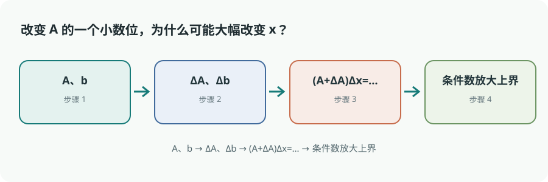

# 矩阵和右端项同时出错时，线性系统的解会变多少

> 真正可靠的扰动分析必须保留所有交叉项，并声明分母成立的条件。

在 Ax=b 中，A 可能来自离散化或校准，b 可能来自传感器。两者都可能有误差。扰动理论先把不同来源的误差写进同一等式，再由矩阵范数给出解变化的上界；关键一步不能把 ΔAΔx 项不加说明地删去。



*扰动方程包含 ΔA 和 Δb 的共同作用；只有在 κ(A)α<1 时给出的相对界才成立。*

## 1. 精确扰动方程不丢掉 ΔAΔx

设原系统 Ax=b，扰动后系统 (A+ΔA)(x+Δx)=b+Δb。相减得到 (A+ΔA)Δx=Δb−ΔA x，这是精确恒等式，不是一阶近似。若 A+ΔA 非奇异，直接得到 Δx=(A+ΔA)⁻¹(Δb−ΔA x)。

另一个等价表达式是 AΔx=Δb−ΔA(x+Δx)。这两种形式都正确，但求界时必须避免混用“原始解 x”和“扰动解 x̂=x+Δx”的分母。

## 2. 从逆矩阵范数得到可用的相对界

设 κ(A)=||A||·||A⁻¹||，并令 α=||ΔA||/||A||、β=||Δb||/||b||，使用一致的诱导矩阵范数。若 κ(A)α<1，则 A+ΔA 非奇异，且可通过 Neumann 级数或逆矩阵扰动定理控制 ||(A+ΔA)⁻¹||。

由 ||b||=||Ax||≤||A||||x||，推导出 ||Δx||/||x|| ≤ κ(A)(α+β)/(1−κ(A)α)。分母必须为正；当 κ(A)α 接近 1，上界变得很大。它是上界，不代表每次扰动都会达到上界。

$$
\frac{\|\Delta x\|}{\|x\|}\le\frac{\kappa(A)\,(\alpha+\beta)}{1-\kappa(A)\alpha},\quad \kappa(A)\alpha<1
$$

## 3. 如果只扰动 b，推导明显简化

当 ΔA=0 时，Δx=A⁻¹Δb，得到 ||Δx||/||x||≤κ(A)||Δb||/||b||。此式没有舍入误差模型，只研究输入变化对精确数学问题的影响。

要讨论一个求解器是否可靠，还必须另行分析它计算 x̂ 时产生的舍入误差。条件数大并不意味着调用 numpy.linalg.solve 自身“不稳定”；它表示即使算法稳定，原问题依然可能敏感。

## 4. 数值实验：控制扰动而不是编造误差

构造 A=[[1,1],[1,1+10⁻⁵]]，取 x=[1,1]、b=Ax，之后人为添加指定 Δb。程序独立计算精确解、扰动解以及理论上界；测试只要求真实相对变化不超过理论界（容忍浮点测试误差）。

当 α=0 时，界简化为 κβ；当 κ α≥1 时程序拒绝宣称该公式仍适用。这正是把数学前提写成软件契约。

## 可交互的判断题

改变 A 的一个小数位，为什么可能大幅改变 x？

- **κ=1, α=0**：若 b 的相对变化 β=10⁻⁶，解变化的相对上界为 10⁻⁶。
- **κ=100, α=0**：同样 β=10⁻⁶，相对解误差上界为 10⁻⁴。
- **κ=1000, α=0.002**：κ α=2≥1，标准扰动界的分母条件不成立，不能套用该上界。

## 最小可复现实验

```bash
python 2_Linear_Equation_Solving/01_2.2_Perturbation_Theory.py
```

运行环境：Python 3.10+、NumPy（版本与安装命令见项目 README）；对应的 MATLAB 实验位于同名 .m 文件。两种语言均需检查相应的数值不变量。

## 参考来源

- [Demmel, Applied Numerical Linear Algebra §2.2](https://doi.org/10.1137/1.9781611971446)
- [Higham, Accuracy and Stability](https://doi.org/10.1137/1.9780898718027)
