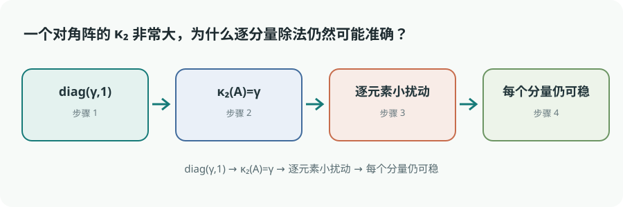

# 为什么范数条件数很大，也不一定意味着每个分量都不可靠

> 逐元素相对扰动提供比单一矩阵范数更细致的数据模型。

考虑 A=diag(10⁸,1)、b=[10⁸,1]。κ₂(A)=10⁸，但方程只是两个独立的标量除法，解 x=[1,1]。范数条件数预测的是最坏方向的相对变化；如果输入误差受结构限制，例如各元素只承受比例误差，那么它可能非常保守。



*整体范数条件数与逐元素扰动敏感性描述不同的误差集合，不能互相替代。*

## 1. 范数扰动界允许误差集中在危险方向

范数型假设 ||ΔA||≤ε||A|| 只约束整体大小。例如 A 的小对角元素为 1，范数型扰动允许它出现远大于自身的绝对扰动（只要相对整个矩阵的范数仍小）。这会放大预测的最坏解误差。

现实中的计量误差往往是逐个参数或逐条边给出相对精度：|Δaᵢⱼ|≤ε|aᵢⱼ|。这种条件对矩阵中的零元素尤其严格：A 中原本为零的分量不允许被扰动为非零。

## 2. 逐元素模型比范数模型承载更多结构信息

用逐元素绝对值 |A| 表示矩阵元素的绝对值，可写 |ΔA|≤ε|A| 与 |Δb|≤ε|b|。如果解由 x̂=x+Δx 表示，误差满足 AΔx=Δb−ΔA x̂，于是 |Δx|≤|A⁻¹|(|Δb|+|ΔA||x̂|)。

该表达式是逐分量不等式，不依赖于把所有误差压成一个范数。它仍然需要 A 非奇异，并且若想进一步给出关于原始 x 的相对比例界，还要明确分母非零以及扰动后的可解性。

$$
|\Delta x|\le |A^{-1}|\left(|\Delta b|+|\Delta A|\,|\hat x|\right)
$$

## 3. 对角阵揭示为什么粗糙条件数会误导

令 A=diag(γ,1)、b=[γ,1]，γ≫1。若每个非零 aᵢᵢ 和 bᵢ 只改变至多 ε 的相对比例，则新的分量解为 x̂ᵢ=(1+δbᵢ)/(1+δaᵢ)，前向分量误差至多约 2ε/(1−ε)，不依赖 γ。

这不能反推整个问题是“良态的”：若允许右端向量在第一项很大的尺度下向第二项引入绝对扰动，范数意义下仍可能发生巨大变化。关键差异在于允许哪一类扰动。

## 4. 用测试显式区分两种数据模型

程序分别实现逐元素相对变化，并计算对角系统各分量的最大相对解误差；再报告 κ₂(A)。两项数据可以同时成立：κ₂(A)=10⁸，却有约 10⁻⁶ 级的逐分量变化。数字来自明确的教学扰动，不代表真实测量误差。

若存在零分母、不确定零结构或参数间相关误差，逐元素模型需要重新定义；不要直接拿它替代所有实际误差评估。

## 可交互的判断题

一个对角阵的 κ₂ 非常大，为什么逐分量除法仍然可能准确？

- **γ=10²**：范数条件数为 100；逐分量比例误差仍主要受 ε 控制。
- **γ=10⁶**：范数条件数为一百万；零结构和逐元素比例约束没有改变。
- **γ=10⁸**：范数条件数为一亿；不能因此断言两次独立除法的相对误差必然巨大。

## 最小可复现实验

```bash
python 2_Linear_Equation_Solving/02_2.2.1_Relative_Perturbation_Theory.py
```

运行环境：Python 3.10+、NumPy（版本与安装命令见项目 README）；对应的 MATLAB 实验位于同名 .m 文件。两种语言均需检查相应的数值不变量。

## 参考来源

- [Demmel, Applied Numerical Linear Algebra §2.2.1](https://doi.org/10.1137/1.9781611971446)
- [Higham, componentwise backward error analysis](https://doi.org/10.1137/1.9780898718027)
