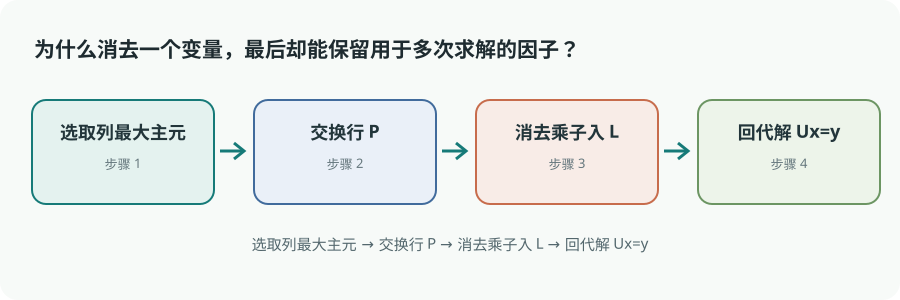

# 把高斯消去拆开看：行交换、乘子与三角求解

> 带选主元的 LU 分解是一个有精确定义的数据变换。

高斯消去不是把方程组的数字任意改写，而是连续对当前主元列执行行操作，使对角线下方逐步变成零。选主元时必须交换行，这些交换累积成置换矩阵 P；消去乘子进入 L，保留下来的上三角部分进入 U。



*对原系统先作用置换 P，再通过 L 和 U 依次完成前代和回代，因子可以重复使用。*

## 1. 从两行消去看乘子

考虑 A=[[2,1],[4,3]]。第一列的第二行减去首行的 2 倍得到上三角行；乘子为 2，故可构造 L=[[1,0],[2,1]]、U=[[2,1],[0,1]]。直接在代数上验证 LU=A，即可看到乘子存放了消去的历史。

但数值计算如果首先遇到特别小的主元，乘子可能非常大。下一步不仅要记录消去，还必须为每一列选择稳定的主元候选。

## 2. 部分选主元的关系式是 PA=LU

在第 k 步，从第 k 列的行 k…n 中寻找绝对值最大元素，与第 k 行交换；置换矩阵 P 汇总这些行交换。该算法通常称作 GEPP。最终 PA=LU，L 是单位下三角，U 是上三角；行交换还要同步更新 L 中已经完成的乘子列。

这一约定下求解 Ax=b 的顺序为 Pb，前代 Ly=Pb，回代 Ux=y。部分选主元不是无条件避免增长的证明；它只保证消去乘子的绝对值在常规非奇异步骤中不超过 1。

$$
PA=LU,\qquad Ly=Pb,\qquad Ux=y
$$

## 3. 复杂度与多右端项

对一般 n×n 稠密矩阵，分解的主导算术成本为 (2/3)n³；每个右端项的前代和回代约为 O(n²)。不要把求逆作为默认实现，因为只要求 x 时显式形成 A⁻¹并不必要。

若 A 不变而 b 有很多组，重复使用 LU 因子比每组重新分解成本更低。大型生产环境通常依赖 LAPACK 或封装了 LAPACK 的库；本文手写版本仅用于揭示算法步骤与验证不变量。

## 4. 测试应检查恒等式而不只检查解

给出 A=[[0,2],[1,3]]，如果不交换第一行就会遇到零主元；部分选主元交换两行后仍可分解。程序检查 P@A 与 L@U 的范数差、L 的单位对角、U 的下三角零结构，并使用得到的因子求解一个给定 b。

精确恒等式的浮点实现可能有舍入偏差，因此检查采用与矩阵尺度相关的合理容差，而不是把每个浮点元素要求严格逐位相等。

## 可交互的判断题

为什么消去一个变量，最后却能保留用于多次求解的因子？

- **无交换**：首主元为 0：不能以它作为除数进行普通消去。
- **交换行**：交换两行后主元为 1：消去继续，满足 PA=LU。
- **多次求解**：同一 A 对多个 b：保留 P、L、U，只重复三角求解。

## 最小可复现实验

```bash
python 2_Linear_Equation_Solving/03_2.3_Gaussian_Elimination.py
```

运行环境：Python 3.10+、NumPy（版本与安装命令见项目 README）；对应的 MATLAB 实验位于同名 .m 文件。两种语言均需检查相应的数值不变量。

## 参考来源

- [Demmel, Applied Numerical Linear Algebra §2.3](https://doi.org/10.1137/1.9781611971446)
- [SciPy lu_factor (LAPACK getrf)](https://docs.scipy.org/doc/scipy/reference/generated/scipy.linalg.lu_factor.html)
