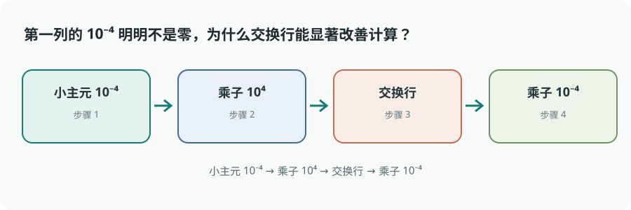

# 一个过小的主元，如何让正确的方程算出错误答案

> 用两行矩阵把数值消去中的误差放大过程完整展开。

取 A=[[10⁻⁴,1],[1,1]]、b=[1+10⁻⁴,2]，真实解是 [1,1]。如果不交换行，第一步乘子为 10⁴，后续会计算两个很大的数之间的差；相同矩阵经部分选主元先交换两行，乘子的大小只有 10⁻⁴。



*同一个矩阵仅通过行交换就把首步消去乘子的量级从 10⁴ 降为 10⁻⁴。*

## 1. 大乘子不只是计算量问题

无选主元消去时，第一步乘子 m=1/10⁻⁴=10⁴。更新第二行的右端项和系数时会出现 2−10⁴(1+10⁻⁴)、1−10⁴ 这样的表达式；两个中间量尺度明显大于原始输入。

对有效数字较少的教学浮点模型，原本重要的低位可能在大数运算和相减中丢失。若在完整二进制双精度下进行，该例未必会显著失败；风险随精度和规模变化，不能伪称它在任意硬件上都会失败。

## 2. 行交换把危险主元换成大主元

部分选主元选择当前列绝对值最大的可用元素。两行交换之后首主元为 1，下一行乘子为 10⁻⁴；对比原先 10⁴ 的巨大乘子，有效减小了中间放大。

如果把置换后的矩阵称为 PA，那么仍写 PA=LU，而不是无条件写 A=LU。恢复原问题的右端项时也必须施加相同置换 Pb。

$$
m_{\mathrm{no\ pivot}}=10^4,\qquad m_{\mathrm{pivot}}=10^{-4}
$$

## 3. 选主元的保证与没有保证

在一般 GEPP 的非零主元步骤，每个 L 的消去乘子满足 |lᵢₖ|≤1。但是 U 的元素仍可能出现明显增长；Wilkinson 矩阵展示了一个最坏情况：增长因子可达到 2ⁿ⁻¹。因此“部分选主元保证无条件稳定”是错误结论。

部分选主元对多数实际稠密矩阵表现可靠；当算法的数值前提或问题结构特殊，仍要检查增长、残差和条件数。

## 4. 用不同精度做可复现实验

教学程序先计算不选主元与选主元时的首步乘子，再使用 NumPy float64 稠密求解器检查原系统残差。它并未模拟固定四位有效数字的舍入规则；如要进行真实低精度仿真，必须另外实现量化操作并说明每步舍入方式。

测试先验证两种消去顺序对乘子大小的影响，再验证 GEPP 的 PA−LU 重构残差；对异常小主元和非有限输入，程序给出明确错误，而不是静默返回不可信结果。

## 可交互的判断题

第一列的 10⁻⁴ 明明不是零，为什么交换行能显著改善计算？

- **不选主元**：首步乘子 10⁴；在低精度算术中，较大的中间量可能吞噬低位。
- **部分选主元**：先交换两行，乘子变为 10⁻⁴；不会把这一例中的小数作为除数。
- **边界**：GEPP 的乘子 ≤1，不代表 U 元素增长因子在所有矩阵上都接近 1。

## 最小可复现实验

```bash
python 2_Linear_Equation_Solving/2.4_Error_Analysis/00_2.4.1_The_Need_for_Pivoting.py
```

运行环境：Python 3.10+、NumPy（版本与安装命令见项目 README）；对应的 MATLAB 实验位于同名 .m 文件。两种语言均需检查相应的数值不变量。

## 参考来源

- [Demmel, Applied Numerical Linear Algebra §2.4.1](https://doi.org/10.1137/1.9781611971446)
- [Nick Higham, growth factor in Gaussian elimination](https://nhigham.com/2020/07/14/what-is-the-growth-factor-for-gaussian-elimination/)
