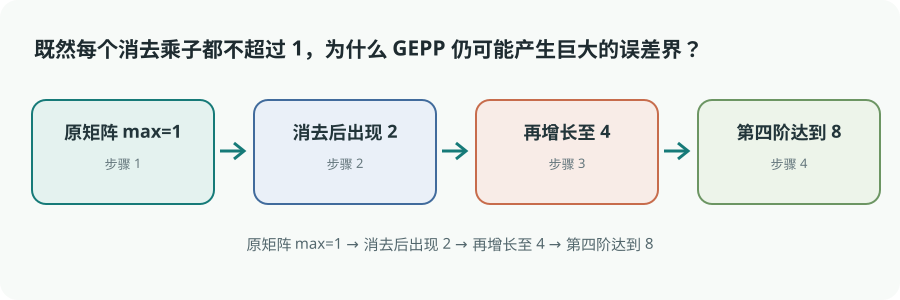

# 高斯消去为什么通常稳定，却仍存在指数增长的反例

> 增长因子决定了误差分析中的关键量，条件数描述的是另一件事。

数值稳定性的论证要跟踪每一步的舍入误差，尤其是上三角因子 U 的中间元素是否远大于原矩阵。部分选主元能限制 L 的乘子，却不自动限制 U 的增长。Wilkinson 构造提供了最坏情况，也提醒我们把理论最坏界与实际残差分开。



*Wilkinson 型例子在并列主元规则下增长因子为 2ⁿ⁻¹；它说明理论最坏界不能被忽略。*

## 1. 向后误差不是解的前向误差

假设计算出的分解为 P A≈L̂Û。定义重构向后误差 E=P A−L̂Û；如果 E 很小，说明因子准确地分解了附近的一张矩阵，但不保证求得的解和真实解很近。后者仍然取决于 A 的条件数。

标准浮点误差分析常得到逐元素形式 |E|≤γ_{c n}|L̂||Û|，其中 γ_k=k u/(1−k u)，常数 c 受具体算法和求和组织影响。这里用“适当的 O(n) 下标”表述，不把某个特定实现的常数伪装为普适定理。

## 2. 增长因子观测的是中间矩阵

令 ρ=max_{i,j,k}|aᵢⱼ^(k)| / max_{i,j}|aᵢⱼ|，分子涵盖消去中实际出现的尾随矩阵元素（含 U）。如果 ρ 很大，舍入误差界里与 |U| 有关的项可能显著放大。

GEPP 对非零主元的列中选绝对值最大元素，保证每步消去乘子绝对值 ≤1；但数学上最坏增长因子仍可达到 2ⁿ⁻¹。这是最坏上界，不是典型随机矩阵性能预测。

$$
\rho_n=\frac{\max_{i,j,k}|a_{ij}^{(k)}|}{\max_{i,j}|a_{ij}|}\le 2^{n-1}\quad(\mathrm{GEPP})
$$

## 3. 四阶 Wilkinson 矩阵把增长写成可算数字

取四阶矩阵，主对角为 1、主对角以下为 −1、最右列全为 1，其余上三角非末列为 0。按 GEPP 常见的“并列取当前行”规则消去，最后一列依次出现 1、2、4、8，因而 ρ=8=2³。

这一例中原矩阵元素最大绝对值仅为 1，所以最后的 8 就是增长因子。程序计算各步最大绝对值而非仅看最终 LU 的残差，避免把不同指标混淆。

## 4. 实际诊断与生产求解分开

即使出现较大增长，也不能仅凭增长因子断言该次求解的前向误差必定大。进一步测量 PA−LU、b−Ax̂、条件数，才能理解具体求解是否可信。

手写 LU 的用途是解释和测试；真实大规模求解应使用经验证的库。实际性能或稳定性需要给出矩阵类别、精度、维度和运行条件，不能从一个四阶反例泛化到所有输入。

## 可交互的判断题

既然每个消去乘子都不超过 1，为什么 GEPP 仍可能产生巨大的误差界？

- **n=2**：Wilkinson 型增长因子 2¹=2。
- **n=3**：Wilkinson 型增长因子 2²=4。
- **n=4**：Wilkinson 型增长因子 2³=8；不表示所有四阶矩阵都会增长八倍。

## 最小可复现实验

```bash
python 2_Linear_Equation_Solving/2.4_Error_Analysis/01_2.4.2_Formal_Error_Analysis_of_Gaussian_Elimination.py
```

运行环境：Python 3.10+、NumPy（版本与安装命令见项目 README）；对应的 MATLAB 实验位于同名 .m 文件。两种语言均需检查相应的数值不变量。

## 参考来源

- [Higham, What Is the Growth Factor for Gaussian Elimination?](https://nhigham.com/2020/07/14/what-is-the-growth-factor-for-gaussian-elimination/)
- [NIST Matrix Market, Wilkinson matrix](https://math.nist.gov/MatrixMarket/deli/Wilkinson/information.html)
- [Demmel, Applied Numerical Linear Algebra §2.4.2](https://doi.org/10.1137/1.9781611971446)
