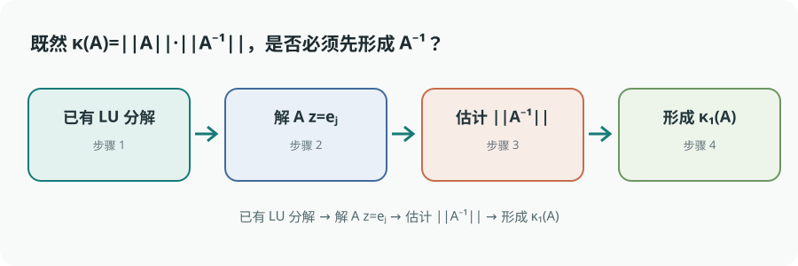

# 怎样估计条件数，而不显式求出整个逆矩阵

> 从定义出发，区分精确小规模诊断和大型系统的逆范数估计器。

矩阵条件数越大，解可能对输入扰动越敏感。但求出完整逆矩阵可能比已有 LU 分解后多次三角求解更昂贵，也会引入额外误差。常用数值库不必显式形成 A⁻¹ 就能估计它的范数；在小矩阵上，我们还可以使用基向量求解构造可检查的参考量。



*小规模教学基线可用 n 个基向量求解检验条件数；大型问题应使用少量求解的估计器。*

## 1. 一范数与逆矩阵列和

矩阵的一范数 ||A||₁ 等于各列绝对值和的最大值。对非奇异 A，κ₁(A)=||A||₁||A⁻¹||₁。因为 A⁻¹ 的第 j 列恰是线性系统 A z=e_j 的解，求解所有 n 个单位基向量就能计算 ||A⁻¹||₁，而不必调用显式逆函数。

但这个做法需要 n 次求解：已经有 LU 因子时仍需总计 O(n³) 量级的三角求解工作。它只适合教学/小规模验证，不能冒充快速条件数估计器。

## 2. 真正的估计器通过少数求解探测危险方向

现代 1-范数估计方法（如 Hager/Higham 类估计）用少量 A 和 Aᵀ 方向的线性求解构造对 ||A⁻¹||₁ 的估计，不显式形成全部 n 列。实作通常还包含符号向量、迭代更新和停止规则，不应把简单的“两次求解”误写成完整 Hager 算法。

已有 LU 因子时，每次调用 A⁻¹ v 或 A⁻ᵀ v 都可以复用三角求解。估计器返回的是估计值，不是严格保证等于精确条件数。可用官方 LAPACK 的条件数估计接口进行工程交叉检查。

$$
\kappa_1(A)=\|A\|_1\|A^{-1}\|_1,\quad \|A^{-1}\|_1=\max_j\|A^{-1}e_j\|_1
$$

## 3. 条件数和矩阵尺度

对 A=diag(1,10⁻⁶)，一范数条件数为 10⁶；如果把整个 A 乘以常数 c，κ₁(cA)=κ₁(A)。这反映条件数描述的是相对放大而非矩阵绝对大小。

不过，单独缩放行和列可以改变常用范数下的条件数，也会改变求解器的数值工作状况；这种缩放不能自动修正全部建模误差。

## 4. 参考值与近似估计应分开报告

程序使用 NumPy solve 分别求解 A z=e_j，累积列绝对值和，从而获得 κ₁(A) 的教学参考值；然后与 numpy.linalg.cond(A,p=1) 对照。该方法未构成高效大型条件数估计器。

若需要可扩展工程估计器，应使用 LAPACK 或 SciPy 的相应接口，并报告使用的范数与估计方法。本文不虚构某个估计器的误差百分比或性能提升。

## 可交互的判断题

既然 κ(A)=||A||·||A⁻¹||，是否必须先形成 A⁻¹？

- **单位阵**：A=I：κ₁(A)=1，对所有向量的相对放大一致。
- **对角阵**：A=diag(1,10⁻⁶)：κ₁(A)=10⁶；对小对角方向非常敏感。
- **缩放**：A 乘统一常数 c：κ₁(cA)=κ₁(A)，相对敏感性不变。

## 最小可复现实验

```bash
python 2_Linear_Equation_Solving/2.4_Error_Analysis/02_2.4.3_Estimating_Condition_Numbers.py
```

运行环境：Python 3.10+、NumPy（版本与安装命令见项目 README）；对应的 MATLAB 实验位于同名 .m 文件。两种语言均需检查相应的数值不变量。

## 参考来源

- [Demmel, Applied Numerical Linear Algebra §2.4.3](https://doi.org/10.1137/1.9781611971446)
- [LAPACK gesvx reciprocal condition estimate](https://www.netlib.org/lapack/explore-html/d5/dbe/group__gesvx_ga9f785df2efd9d9f8408e2de492f28673.html)
- [NumPy condition number](https://numpy.org/doc/stable/reference/generated/numpy.linalg.cond.html)
