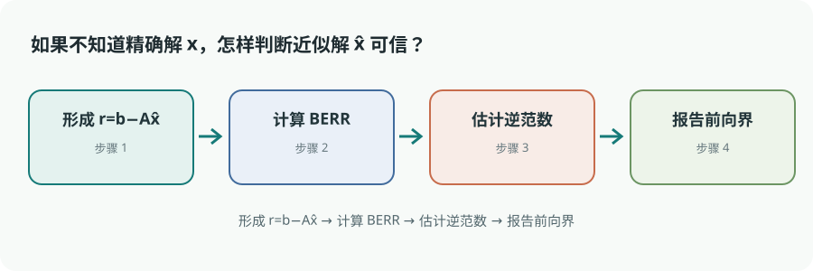

# 求得一个近似解后，如何计算真正有意义的误差指标

> 把残差、分量后向误差和前向误差界放在不同的位置。

真实解往往未知，但原始 A、b 和计算的 x̂ 都已知，因此可以形成残差 r=b−Ax̂。残差不仅是一项检查，还能导出前向误差的数学上界。然而“残差小”“误差界小”“LAPACK 返回 FERR”并不是三个可直接替换的判断。



*残差可计算，BERR 衡量逐元素后向误差；前向界额外依赖逆矩阵范数估计。*

## 1. 残差是已知数据可形成的量

定义 r=b−Ax̂。若原系统 Ax=b 且 A 非奇异，则 x−x̂=A⁻¹r。因此 ||x−x̂||∞≤||A⁻¹||∞||r||∞。这是一条精确数学上界；程序估计 ||A⁻¹||∞ 时还会额外引入计算误差。

重要的是保持符号一致。如果另一篇文章把残差定义为 Ax̂−b，误差向量公式就会多一个负号，但其范数上界不变。

## 2. 分量后向误差刻画相对数据扰动

对每个方程 i，分母 dᵢ=(|A||x̂|+|b|)ᵢ 表示该行所参与数据的自然尺度。定义 berr=max_i |rᵢ|/dᵢ（dᵢ=0 时按零/零为零、正数/零为无穷大处理）。它衡量让 x̂ 成为邻近问题精确解所需的逐元素相对修正。

berr 能揭示“某行输入极小但残差也小”的问题，比只用 ||r|| 的单一尺度更有辨识力；但 berr 不是解的真实前向误差，仍要结合条件数或更精确的分量误差分析。

$$
\|x-\hat x\|_\infty\le\|A^{-1}\|_\infty\|b-A\hat x\|_\infty
$$

## 3. 与真实误差相比，上界可能较松

对小矩阵的教学实验，可用 numpy.linalg.solve(A,b) 产生参考解，并比较真实 ||x−x̂||∞ 与 ||A⁻¹||∞||r||∞。为突出数学关系，教学代码用求解单位基向量的方法得到逆范数参考量；它并不是面向大型系统的高性能实现。

同一结果还可以计算分量型示例界 |x−x̂|≤|A⁻¹||r|，把符号消去与范数估计的松弛区别出来。不要用少量实验直接声称一个误差界在所有输入上都紧。

## 4. LAPACK 的 FERR、BERR 与 RCOND 各司其职

LAPACK 的 expert driver（如 xGESVX）可以给出 RCOND（倒数条件数估计）、FERR（前向误差界估计）和 BERR（分量相对后向误差）。这些量建立在特定算法、缩放与误差估计流程上；本课程的简化代码不等同于完整 xGESVX。

若 A 病态到接近工作精度的极限，估计界可能丧失可靠性；应报告数值精度、条件估计、缩放、残差计算方式，以及可能的失败情形。

## 可交互的判断题

如果不知道精确解 x，怎样判断近似解 x̂ 可信？

- **残差**：r=b−Ax̂ 可直接计算；它不是前向误差 x−x̂。
- **后向误差**：BERR 按每行数据尺度归一化；仍无法单独保证 x 的每个分量准确。
- **前向误差界**：||x−x̂||∞≤||A⁻¹||∞||r||∞，需要估计或界定逆矩阵范数。

## 最小可复现实验

```bash
python 2_Linear_Equation_Solving/2.4_Error_Analysis/03_2.4.4_Practical_Error_Bounds.py
```

运行环境：Python 3.10+、NumPy（版本与安装命令见项目 README）；对应的 MATLAB 实验位于同名 .m 文件。两种语言均需检查相应的数值不变量。

## 参考来源

- [LAPACK gesvx: RCOND, FERR, BERR](https://www.netlib.org/lapack/explore-html/d5/dbe/group__gesvx_ga9f785df2efd9d9f8408e2de492f28673.html)
- [Demmel, Applied Numerical Linear Algebra §2.4.4](https://doi.org/10.1137/1.9781611971446)
