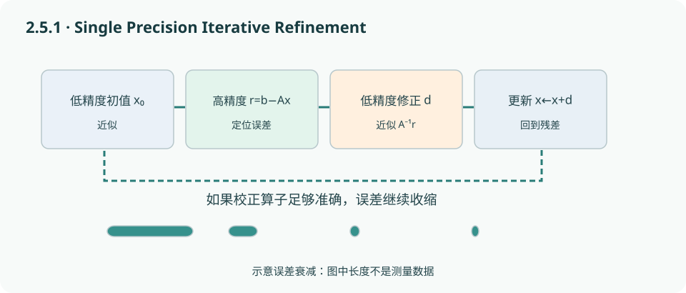

# 迭代改进：为什么低精度分解配合高精度残差仍能修正解

> 把“求解一次”拆成初始解、残差、校正、更新的循环，并追踪混合精度的误差来源。

设原系统 Ax=b，低精度 LU 解算器给出 x₀。它可能还没足够精确，但我们能使用原始高精度 A、b 计算 r₀=b−Ax₀。若求出校正 d₀≈A⁻¹r₀，就可令 x₁=x₀+d₀。关键不是“重复求解”四个字，而是每步都使用更精确的残差定位当前误差。



*每一轮的残差定位当前误差，低精度因子再把残差映射成校正量；图中收敛轨迹不是实验数据。*

## 误差为什么能够被重新暴露

定义 eₖ=x−xₖ，真实残差满足 rₖ=b−Axₖ=Aeₖ。若修正方程 Ad=r 精确求解，则 xₖ+d=x；迭代的价值来自在有限精度中反复近似完成这个校正。因而残差计算的精度与修正方程的求解精度承担不同职责，二者不能在描述中混为一谈。

设固定低精度分解构成的有效求解算子为 M⁻¹，则 eₖ₊₁=(I−M⁻¹A)eₖ（忽略这一步的舍入误差）。只要所用误差传播算子足够收缩，改进可能成功；若它不收缩，反复更新反而可能停滞或放大噪声。

## 混合精度路线要分清三种工作

一种可复现实验是：用 float32 对 A 求出近似解和每轮修正，用 float64 计算原问题残差，并把 x 保存在 float64 中。这样低精度主要承担因子分解与修正求解的成本，高精度用于判断还差多少。生产实现一般会复用一次因子而非每轮重新分解；本文 NumPy 对照程序为方便观察，会显式声明其简化之处。

不要把“单精度迭代改进”理解为所有运算都在 float32 中完成，更不能声称低精度残差通常能带来双精度精度。混合精度能否收敛与工作精度单位舍入误差、矩阵条件数、因子的增长以及残差累计精度有关。

核心关系：

$$
r_k=b-Ax_k,\qquad x_{k+1}=x_k+M^{-1}r_k
$$

## 在 2×2 矩阵上手算一次修正

令 A=[[1,1],[1,1.001]]、真实解 x=[1,1]、b=[2,2.001]。假设初始近似 x₀=[1.01,0.99]，则 Ax₀=[2,2.00099]，r₀=[0,0.00001]。因为 A 的两行差只含 0.001x₂，解 Ad=r 可得 d=[−0.01,0.01]，所以 x₁=[1,1]。

此手算仅演示残差的修正含义；它没有模拟任何具体 float32 LU 的真实舍入行为。配套代码将独立生成实际的 float32 初值，再以 float64 残差运行循环，输出每轮相对残差和真实参考误差。

## 为什么监测更新量不能代替监测后向误差

当修正量变小，可能是算法已经收敛，也可能是修正方程求解失去有效数字。一个较稳健的停止判断要看 ||b−Axₖ||/(||A||||xₖ||+||b||)，同时观察修正幅度、迭代次数与是否出现停滞；实际应用还应在必要时观察分量后向误差。

对于 κ(A)u_low 接近或超过 1 的系统，使用低精度因子可能不提供足够好的近似逆，此时更高精度的因子、预条件器或 GMRES 型改进才有可能改进效果，不能用固定若干步保证成功。

## 与 LAPACK 和实验的边界

LAPACK xGERFS/xGERFSX 类流程管理误差估计与改进；专家驱动 xGESVXX 还包含缩放与条件诊断。下面的教学实现不是这些驱动的完整替代品，不会虚构 FERR 或收敛保证。

交互图中的收缩因子只是可调误差传播模型，反映 θ<1 时误差几何下降、θ≥1 时不能保证收敛。图上的曲线是示意计算而不是实际硬件基准，真实程序以每轮数值残差为准。

## 可调数值模型

示意修正的收缩因子 θ（不是实测）。这是对关键数学结构的交互探索：按图示改变参数，观察由公式推导出的量；并非实测性能或任意输入的算法保证。

## 复现实验与反例

```bash
python "2_Linear_Equation_Solving/2.5_Improving_the_Accuracy_of_a_Solution/00_2.5.1_Single_Precision_Iterative_Refinement.py"
```

同名 MATLAB 脚本使用等价的数学测试。代码包含定量断言和例外/边界条件，详见仓库 tests/test_chapter2_advanced.py。

## 参考来源

- [Demmel, Applied Numerical Linear Algebra, Chapter 2](https://doi.org/10.1137/1.9781611971446)
- [LAPACK Working Note 165: Error Bounds from Extra Precise Iterative Refinement](https://www.netlib.org/lapack/lawnspdf/lawn165.pdf)
- [LAPACK xGESVXX iterative refinement](https://github.com/Reference-LAPACK/lapack/blob/master/SRC/dgesvxx.f)
