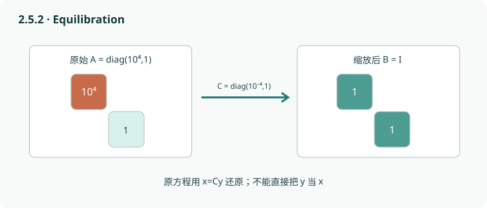

# 矩阵均衡化：缩放能修复量级，却不会自动治好病态

> 从原方程到左右对角缩放的等价变换，并用一个矩阵和一个反例辨别效果。

求解 Ax=b 时，不同变量和不同方程的物理单位可能让矩阵元素跨越多个数量级。对角缩放用便宜的变换改善数值量级：选择正的对角矩阵 R、C，令 B=RAC、c=Rb，求 By=c，再还原 x=Cy。整个过程在精确算术中等价，但缩放改变了数值求解过程的形状。



*等价的左右缩放会改变数值坐标；图中对角系统的条件数改善不代表任意矩阵都有此性质。*

## 等价变换必须连同右端项与未知量一起写

若将 A 左乘 R，却忘记把 b 同时左乘 R，得到的将不是同一方程；若采用列缩放 C 却忘记从 y 恢复 x=Cy，报告的将是另一组变量。正确代入是 RACy=Rb、x=Cy，验算时仍使用原始残差 b−Ax。

当 R、C 都非奇异时，精确问题保持等价。但 ||RAC|| 与 κ(RAC) 的变化属于新的缩放坐标体系；这不等于原物理测量误差已经减小。

## 用 1-范数和对角例子看清改进

考虑 A=diag(10⁶,1)，b=[10⁶,1]，真实 x=[1,1]。κ₂(A)=10⁶；取 C=diag(10⁻⁶,1)，R=I，便得到 B=I、κ₂(B)=1、c=b。求得 y=[10⁶,1]，再用 x=Cy 恢复原解。注意：y 不等于 x，缩放之后的变量大小也改变了。

这个例子能说明坐标不均衡；不能说明任意病态矩阵都能通过行列缩放变良态。设 A=[[1,1],[1,1+δ]]，若 δ 很小，近线性相关不会因为简单均衡化而消失。

核心关系：

$$
RACy=Rb,\qquad x=Cy
$$

## 实际算法的规模估计不是单独套一个固定公式

常用的均衡化过程先根据行最大元素估算 R，再在行缩放后根据列最大元素估算 C，使各行列元素的数量级更均匀。LAPACK xGEEQU 会返回缩放因子、行列比例和矩阵最大元素，用于决定是否需要缩放，而不是盲目改变任何 A。

在使用极大或极小缩放因子时，还必须考虑溢出与下溢；如果某行或某列全零，缩放因子无从定义，这也表明方阵求解问题可能已经奇异。本文教学代码对零尺度显式拒绝，不做静默替换。

## 反例：条件数可能仍大甚至变得更差

若各列几乎线性相关，缩放无法增加它们之间的真正独立性。对非正规矩阵或某些稀疏结构，简单的行最大值/列最大值缩放不一定降低二范数条件数，也不一定减少总体前向误差。

因此实验要报告 κ(A)、κ(RAC)、原始残差 ||b−Ax|| 与缩放后问题的残差，并说明使用的是何种范数。不能只报告矩阵元素更“好看”就宣布精度提升。

## 一个交互图说明“缩放的是坐标”

滑动对角量级差 10ˢ，左图呈现原矩阵主对角元素 [10ˢ,1]，右图呈现经列缩放后的 [1,1]。在这个专门构造的对角算例中，数值条件数从 10ˢ 变为 1；这是模型特例，而非任意矩阵的性能预测。

代码还给出近相关矩阵的对照，验证即使每行被缩放到相近量级，也可能保持很大的条件数。

## 可调数值模型

对角矩阵量级差（10 的指数 s）。这是对关键数学结构的交互探索：按图示改变参数，观察由公式推导出的量；并非实测性能或任意输入的算法保证。

## 复现实验与反例

```bash
python "2_Linear_Equation_Solving/2.5_Improving_the_Accuracy_of_a_Solution/01_2.5.2_Equilibration.py"
```

同名 MATLAB 脚本使用等价的数学测试。代码包含定量断言和例外/边界条件，详见仓库 tests/test_chapter2_advanced.py。

## 参考来源

- [Demmel, Applied Numerical Linear Algebra, Chapter 2](https://doi.org/10.1137/1.9781611971446)
- [LAPACK DGEEQU: row/column scaling](https://netlib.org/lapack/explore-html/d5/d8a/group__geequ_ga7238812c5c26fc2fbe8bbbc22b6ee885.html)
