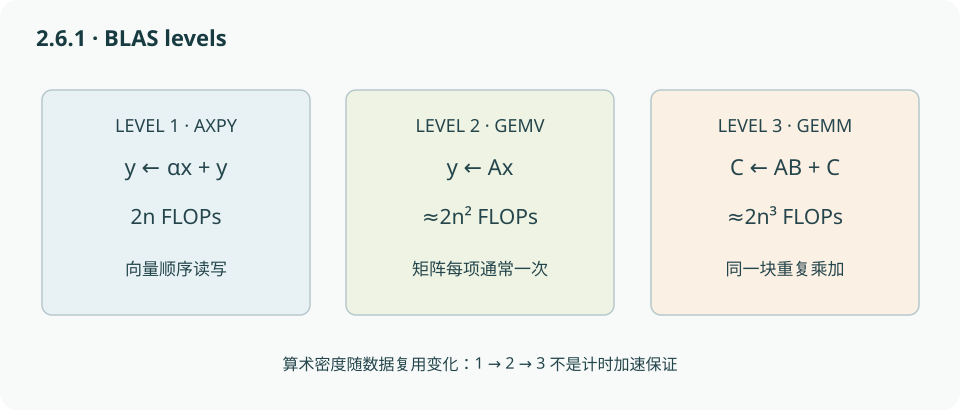

# BLAS 三级为何代表三种完全不同的数据复用方式

> 用浮点运算数与主存搬运下界认识 AXPY、GEMV 和 GEMM，而非只背接口名字。

BLAS 是数值软件的基础接口约定，不是某个唯一的实现。Level 1 处理向量—向量运算，Level 2 处理矩阵—向量，Level 3 处理矩阵—矩阵。重要差异不是 API 名称，而是同一块输入数据在被移出快速存储前能参与多少次计算。



*同为乘加：Level 1 一条数据流、Level 2 流过大矩阵、Level 3 让小块数据反复复用。*

## Level 1：一次线性扫描会被带宽限制

以 y←αx+y（AXPY）为例，长度 n 的实数向量约有 2n 次浮点运算（每项一乘一加）；若每个 float64 占 8 字节，理想读写最低要读取 x、读取 y、写回 y，合计约 24n 字节，运算密度约为 1/12 FLOP/byte。

缓存、写分配、对齐、别名和线程调度会让实际传输量与这个模型不同。该值是方便理解的流式访存模型，不是任何机器上测得的精确常数。

## Level 2：矩阵向量乘法仍难以重复使用大矩阵

对 y←Ax，稠密 A 的每个元素通常只参与一次乘加。n×n 情况下约为 2n² FLOPs，仅 A 的读取就需要约 8n² 字节，因此 n 足够大时运算密度上界大约 1/4 FLOP/byte。还需计入 x 和 y 的读写，真实密度通常更低。

尽管现代 BLAS GEMV 可利用 SIMD 与多核，性能往往仍受到数据传输约束。它并不因为“用了 BLAS”就自动变成计算密集型操作。

核心关系：

$$
I_{\mathrm{GEMM}}\approx\frac{2n^3}{32n^2}=\frac n{16}\ \mathrm{FLOP/byte}
$$

## Level 3：矩阵乘法让每个载入元素反复参与运算

对 C←AB+C，稠密 n×n 矩阵乘法约为 2n³ FLOPs。若 A、B、C 的读写在理想缓存层次中只需按 n² 量级搬运，则运算密度随 n 增长；用 32n² 字节作乐观流量基线可写 I≈n/16 FLOP/byte。

这里的 32n² 是理想化必需流量，不保证任一实现能达到；矩阵不能全部放入缓存时，必须依赖分块、打包和高效内核降低额外搬运。运算量更大，不代表 GEMM 的总时间一定少于 GEMV。

## 用三个标准操作检查维度与语义

AXPY 的输出仍是 n 维向量；GEMV 产生 n 维向量；GEMM 的输出为 n×n 矩阵。转置约定和行主序/列主序是接口的一部分，误把 Aᵀx 当成 Ax 可能产生维度正确但语义错误的结果。

在 NumPy 中，a*x+y、A@x 与 A@B 分别对应这些运算；实际底层是否调用特定 BLAS 内核取决于安装的库与数据布局。我们的单元测试只验证数值和模型算术数，不假定具体后端。

## 从接口正确性进入性能测量

公平的性能对比要锁定维度、数据类型、线程数、热/冷缓存状态、预热次数与计时方法。更要区分理论 FLOPs、最低访存量、实际内存流量和实测吞吐；不应从静态图表报告“加速倍数”。

交互图改变 n，按上述简化流量模型展示三类操作的运算密度趋势。条形差别来自数学模型计算，不是基准测试或硬件保证。

## 可调数值模型

矩阵/向量规模 n（模型，不是速度测试）。这是对关键数学结构的交互探索：按图示改变参数，观察由公式推导出的量；并非实测性能或任意输入的算法保证。

## 复现实验与反例

```bash
python "2_Linear_Equation_Solving/2.6_Blocking_Algorithms_for_Higher_Performance/00_2.6.1_Basic_Linear_Algebra_Subroutines_(BLAS).py"
```

同名 MATLAB 脚本使用等价的数学测试。代码包含定量断言和例外/边界条件，详见仓库 tests/test_chapter2_advanced.py。

## 参考来源

- [Demmel, Applied Numerical Linear Algebra, Chapter 2](https://doi.org/10.1137/1.9781611971446)
- [Netlib BLAS: Level 1/2/3 definitions](https://www.netlib.org/blas/faq.html)
- [Cornell: roofline / arithmetic intensity explanation](https://www.cs.cornell.edu/~bindel/nmds/00-Background/02-Performance.html)
