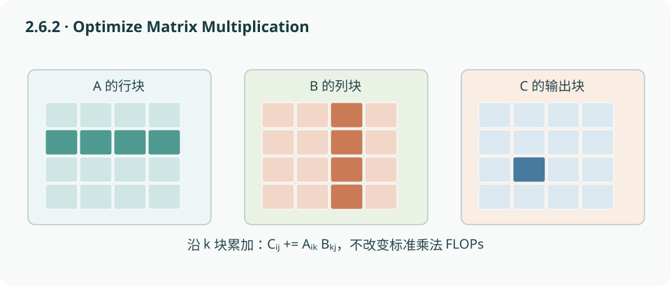

# 分块矩阵乘法：为什么不改变乘法次数也可能明显变快

> 从循环访问顺序、缓存工作集、微内核和块复用构造一条可测试的优化路线。

矩阵乘法 C=AB 的每个 Cᵢⱼ 都是 A 的第 i 行与 B 的第 j 列的点积。朴素 i-j-k 循环与分块实现具有相同的数学结果，但访问数据的次序不同。现代机器从 DRAM 取数据的代价远高于寄存器中的乘加；正确的分块是在有限的快速存储中反复使用刚载入的数据。



*输出块 Cᵢⱼ 累加多个 AᵢₖBₖⱼ 乘积；每次重用的是当前载入的块而非整个矩阵。*

## 循环交换不是改变数学，而是改变空间局部性

朴素 i-j-k 循环每次内层读取 Aᵢₖ 和 Bₖⱼ。对于 C 行主序 NumPy 内存，固定 j 而遍历 k 会跨行访问 B，可能造成较差局部性。换成 i-k-j 时，B 的一行可被连续访问，C 的一行也能重用；但浮点求和顺序改变可能引起微小的舍入差异。

循环顺序的最佳选择还取决于布局、内存层次和编译器。不能简单断言一种六重分块循环在所有矩阵和 CPU 上最快。

## 分块的代数恒等式保证结果正确

将 A 按行列划分为 Aᵢₖ，B 划分为 Bₖⱼ，则 Cᵢⱼ=Σₖ AᵢₖBₖⱼ。对每个输出小块，迭代不同 k 块并累加，使 A 与 B 的小块在局部存储中得到多次使用。

当块边长为 b 时，一个 b×b 的输出块更新约执行 2b³ 次浮点运算，而读入两个 b×b 乘数块只需 O(b²) 数据。这解释了块内运算密度随 b 增大，但输出块、缓存容量、寄存器数和打包开销会限制 b 的选择。

核心关系：

$$
C_{ij}\leftarrow C_{ij}+\sum_k A_{ik}B_{kj}
$$

## 为什么需要面板打包与微内核

高性能 GEMM 通常不仅切分矩阵，还会把 B 面板等数据打包成连续布局，再用针对 SIMD 寄存器的微内核处理若干行列。打包有额外成本，但在足够大的矩阵上可由重复使用摊销。

小矩阵可能由于函数调用、打包和分块循环开销而没有收益。大矩阵中缓存冲突、线程数、NUMA 放置也会改变实际效果。

## 跨语言复现应比较数学正确性而非逐位一致

配套 Python 实现纯 NumPy 的教学三重分块循环，按 C[i:i+b,j:j+b] += A[i:i+b,k:k+b] @ B[k:k+b,j:j+b] 累加；它不是 BLIS 的寄存器级优化内核，也不应作为速度基准。测试用 np.allclose 对比 A@B，并覆盖 n 不能被 b 整除的尾块。

MATLAB 版使用相同分块恒等式和 1-based 索引；两种语言都把块范围裁剪到 n。若数据本身不连续或跨线程共享，还需额外考虑拷贝与数据争用。

## 交互实验：块大小影响复用而非 FLOPs

滑动块边长 b，示意图把 8×8 输出矩阵分成方块，并高亮一个待更新 Cᵢⱼ。数学上的标准 GEMM 运算次数约为 2n³，与 b 无关；块数、单块复用和附加调度成本则随 b 改变。

可视化只解释分块机制，不提供所谓“理论加速比”。实测性能必须在确定硬件、BLAS、线程数与数据布局之后独立基准化。

## 可调数值模型

8×8 示意矩阵的块边长 b。这是对关键数学结构的交互探索：按图示改变参数，观察由公式推导出的量；并非实测性能或任意输入的算法保证。

## 复现实验与反例

```bash
python "2_Linear_Equation_Solving/2.6_Blocking_Algorithms_for_Higher_Performance/01_2.6.2_How_to_Optimize_Matrix_Multiplication.py"
```

同名 MATLAB 脚本使用等价的数学测试。代码包含定量断言和例外/边界条件，详见仓库 tests/test_chapter2_advanced.py。

## 参考来源

- [Demmel, Applied Numerical Linear Algebra, Chapter 2](https://doi.org/10.1137/1.9781611971446)
- [BLAS and LAPACK implementation overview](https://www.netlib.org/lapack/lawnspdf/lawn106.pdf)
- [ETH Zurich, How to Write Fast Numerical Code: matrix multiplication](https://acl.inf.ethz.ch/teaching/fastcode/2026/slides/10-linear-algebra-MMM.pdf)
