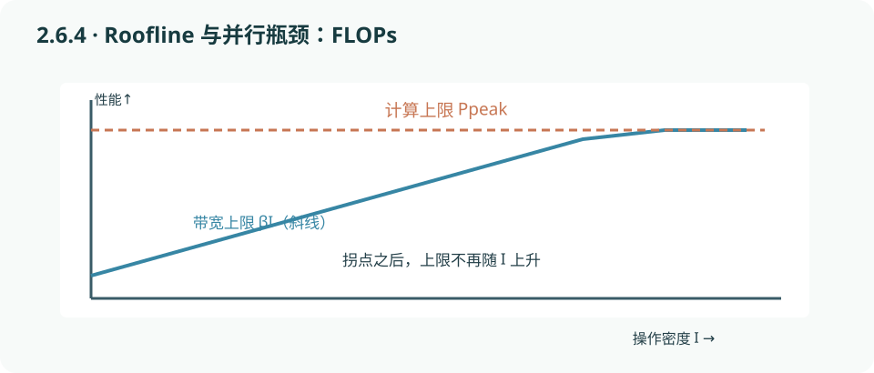

# Roofline 与并行瓶颈：FLOPs 很多也可能跑不快

> 从算术密度和访存带宽解释性能屋顶，再用 Amdahl 定律指出线程数不能消除串行依赖。

一次矩阵运算不仅消耗乘加单元，也需要从内存层次取出 A、B、C。某些算法的理论 FLOPs 很多，但每个数据只使用一次，内存带宽决定速度；另一些内核可以把同一个数据重复使用，才有机会接近计算单元上限。并行还受串行部分、同步和通信约束。



*Roofline 由带宽斜线和计算平台相交形成；高于屋顶的性能不可达到，低于屋顶的原因仍需分析。*

## Roofline 的两个上界来自两种不同资源

设处理器持续计算峰值为 P_peak FLOP/s，内存带宽上界为 β byte/s，算法相对于选定内存层次的算术密度为 I FLOP/byte。性能上界 P ≤ min(P_peak, βI)。当 βI<P_peak 时，属于访存受限；当 βI≥P_peak 时，理论屋顶由计算能力给出。

这个模型本身不保证达到屋顶：指令依赖、访存访问模式、缓存缺失、向量化效率、调用开销和负载不均衡仍可让实际速度更低。峰值、带宽和算术密度必须在同一层次与测量口径下定义。

## GEMV 和 GEMM 为什么落在不同位置

GEMV 的主导运算 2n² FLOPs 与主导矩阵读取约 8n² 字节同阶，I 大致不随 n 增长。理想复用的 GEMM 却能把 O(n³) FLOPs 组织在 O(n²) 规模的数据流之上，运算密度随块大小和矩阵规模增加。

因此分块 GEMM/BLAS3 常对深度学习、稠密分解和多右端项求解至关重要；不过如果数组太小、转换布局频繁或者线程启动成本过大，基于大问题的优化直觉可能不再成立。

核心关系：

$$
P\le\min(P_{\mathrm{peak}},\beta I),\qquad S(p)=\frac1{f+(1-f)/p}
$$

## Amdahl 定律限制可并行部分的收益

若原工作量有比例 f 完全不可并行，其余部分可在 p 个处理单元上理想平均分配，Amdahl 理想加速比 S(p)=1/(f+(1−f)/p)。当 p→∞，最多也只有 1/f。同步、通信和负载不均衡会进一步降低真实加速。

在分块 LU 中，尾随 GEMM 的并行性很高，panel 因数据依赖较强而有一定串行比例。减小 panel 成本、将数据批量送入高效 GEMM，常比盲目增加线程数更有效。

## 一张屋顶线不是硬件 benchmark

网页使用人为设定的 P_peak=200 GFLOP/s、β=50 GB/s，拐点 I=P_peak/β=4 FLOP/byte。滑动算术密度 I，可以精确计算示例上界 min(200,50I)，并在图中标出由带宽屋顶过渡到计算屋顶的位置。

这些数字只是便于手算的示意参数，与用户机器或云主机无关；实验代码只验证公式和单调性，不会伪造任何平台 GFLOP/s 实测值。

## 测量方法比华丽图表更重要

实际测量要约定精度、矩阵形状、存储顺序、BLAS 库、线程绑核/线程数、数据热度、预热次数、重复次数和能耗约束。大规模计算还应考虑 NUMA、网络互联和并行规约误差。

如果高精度解和高性能不可兼得，应明确误差预算、条件数、残差和任务目标；一次高峰吞吐并不代表整个求解器从输入到诊断的耗时最短。

## 可调数值模型

示意操作密度 I，FLOP/byte。该交互展示明确参数与方程下的计算结果，不应解释为任意输入的性能实测或稳定性保证。

## 复现实验与边界检查

```bash
python "2_Linear_Equation_Solving/2.6_Blocking_Algorithms_for_Higher_Performance/03_2.6.4_More_About_Parallelism_and_Other_Performance_Issues.py"
```

MATLAB 对应脚本为同名 .m 文件；测试标准请查看 tests/test_chapter2_advanced.py，并以实际运行记录为准。

## 参考来源

- [Demmel, Applied Numerical Linear Algebra, Chapter 2](https://doi.org/10.1137/1.9781611971446)
- [Williams, Waterman, Patterson: Roofline (2009)](https://escholarship.org/uc/item/5tz795vq)
- [Cornell numerical performance notes](https://www.cs.cornell.edu/~bindel/nmds/00-Background/02-Performance.html)
