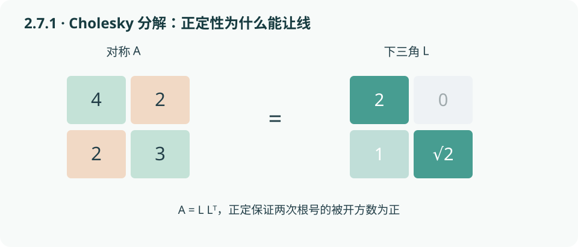

# Cholesky 分解：正定性为什么能让线性求解更简单

> 从二次型的严格正性到 LLᵀ、Schur 补与平方根主元，理解高效与失败条件。

实对称矩阵 A=Aᵀ 不一定正定；只有对每个非零向量 x 都满足 xᵀAx>0，才称对称正定（SPD）。这种结构保证无主元 Cholesky 分解 A=LLᵀ 中每个对角根号的被开方量为正，允许使用较少存储和算术量来解线性系统。



*SPD 的左上主元和 Schur 补都严格为正，因此 Cholesky 的下三角对角元素可取正平方根。*

## 几何解释：正定二次型没有非零平坦或负方向

函数 E(x)=½xᵀAx−bᵀx 的 Hessian 是 A。当 A SPD 时，E 是严格凸的，唯一驻点 Ax=b 也是全局最小点。若 A 仅对称不定，则 E 沿某些方向可以向下下降，平方根因子不再满足无主元正定 Cholesky 的要求。

SPD 性质不仅在数值上好用，也决定了使用共轭梯度、能量范数分析和协方差矩阵模型时能否直接调用相应算法。

## 从 2×2 分解推导每一个根号

设 A=[[a,c],[c,d]]，若 a>0 且 ad−c²>0，则 L=[[√a,0],[c/√a,√(d−c²/a)]]，直接可验证 LLᵀ=A。这里第二个根号中的 d−c²/a 是消去第一行后的 Schur 补，也是 SPD 的必要条件之一。

以 A=[[4,2],[2,3]] 为例，L=[[2,0],[1,√2]]，所以 LLᵀ 恢复原矩阵。若将 d 改为 0，则 Schur 补为 −1，Cholesky 失败不是算法“坏掉”，而是正定性假设被破坏。

核心关系：

$$
A=LL^{\mathsf T},\qquad l_{22}=\sqrt{d-c^2/a}>0
$$

## 为什么无需普通 LU 的行交换

SPD 矩阵的所有顺序主子式都为正；每步消去所生成的 Schur 补仍 SPD，因此每步能选到正的对角主元。常见的 Cholesky 实现不需要一般 GEPP 的行交换逻辑。

对 n×n 稠密 SPD 矩阵，Cholesky 主导成本约 (1/3)n³ FLOPs，而一般稠密 LU 约 (2/3)n³。正定结构还允许只存一半输入，但读写与实际内存占用依赖具体实现。

## 数值计算应区分对称、正定、半正定

只检查 A≈Aᵀ 不能判断 SPD；对称半正定矩阵可能有零特征值，常规 Cholesky 可能在零主元处失败。协方差类或 Gram 矩阵在秩亏时就经常发生这种情况。

数值上对近零特征值十分敏感的矩阵，不能将分解成功直接解释为“每个解分量都准确”；仍需报告条件数和原始残差。

## 图解与代码如何互相验证

图中左侧对称 A 的非对角元素成镜像，右侧 L 的上三角为零；通过 L 的两次三角求解可重构 x。交互滑块改变 a，固定 c=1、d=2，使用 a>½ 确保 Schur 补为正，实时显示两个对角根号的变化。

NumPy 与 MATLAB 示例都使用库 Cholesky 求解，测试 LLᵀ≈A、L 为下三角、解残差小，并在非 SPD 情况要求明确失败。

## 可调数值模型

SPD 2×2 中 a 的大小，A=[[a,1],[1,2]]。该交互展示明确参数与方程下的计算结果，不应解释为任意输入的性能实测或稳定性保证。

## 复现实验与边界检查

```bash
python "2_Linear_Equation_Solving/2.7_Special_Linear_Systems/00_2.7.1_Real_Symmetric_Positive_Definite_Matrices.py"
```

MATLAB 对应脚本为同名 .m 文件；测试标准请查看 tests/test_chapter2_advanced.py，并以实际运行记录为准。

## 参考来源

- [Demmel, Applied Numerical Linear Algebra, Chapter 2](https://doi.org/10.1137/1.9781611971446)
- [LAPACK DPOTRF: Cholesky positive definite factorization](https://www.netlib.org/lapack/explore-html/d2/d09/group__potrf_ga84e90859b02139934b166e579dd211d4.html)
