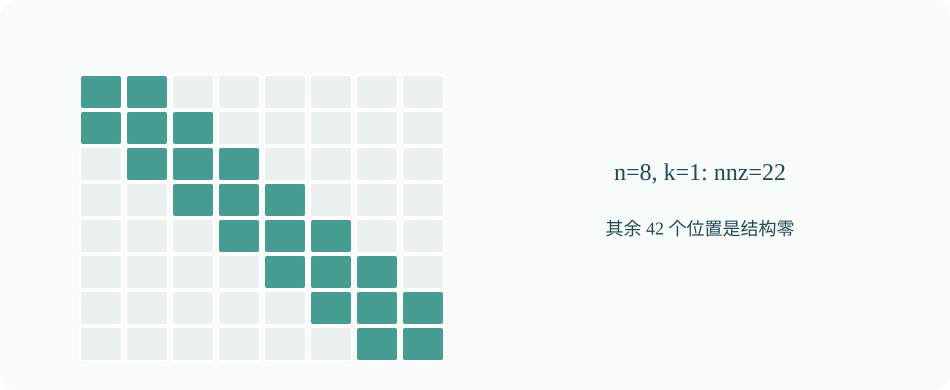

# 带状矩阵：让解算成本跟着带宽而不是 n² 走

> 带宽、压缩存储、三对角消去和主元填充

一维 Poisson 差分给出 −xᵢ₋₁+2xᵢ−xᵢ₊₁=bᵢ，相邻未知量彼此耦合，远处未知量不直接耦合。系数矩阵仍是 n×n，但可用 O(n) 个条目而非 n² 个条目描述。如何正确存储与求解，取决于上下带宽和选主元策略。



## 数学结构从网格相互作用产生

定义下带宽 kₗ、上带宽 kᵤ：当 i−j>kₗ 或 j−i>kᵤ 时 aᵢⱼ 必为零。三对角系统中 kₗ=kᵤ=1，所以最多只有 n 个主对角元素、n−1 个上对角元素和 n−1 个下对角元素，合计 3n−2。

一般带状矩阵的存储量 O(n(kₗ+kᵤ+1))，若带宽固定可看成线性增长；但如果二维网格排列使带宽随 n 增长，这种优势便会下降。

## 两种带状数组布局不能混淆

SciPy solve_banded 的紧凑数组约定 ab[kᵤ+i−j,j]=aᵢⱼ（零基索引），高度 kₗ+kᵤ+1。三对角情况下三行依次装上、主、下对角线，两端的空槽不代表矩阵数据。

LAPACK DGBTRF 的工作存储与紧凑输入不同，允许部分选主元导致 U 中产生额外填充；通常要求 LDAB≥2kₗ+kᵤ+1。把紧凑 SciPy 数组直接当作 DGBTRF 工作区会导致错误。

$$
a_{ij}=0\quad(i-j>k_l\ \mathrm{or}\ j-i>k_u)
$$

## Thomas 消去为什么只有 O(n) 步

对于下对角 aᵢ、主对角 dᵢ、上对角 cᵢ，取 mᵢ=aᵢ/dᵢ₋₁，更新 dᵢ←dᵢ−mᵢcᵢ₋₁、bᵢ←bᵢ−mᵢbᵢ₋₁。最后执行 xᵢ=(bᵢ−cᵢxᵢ₊₁)/dᵢ 的回代。每行只需常数次运算，所以总成本线性。

这些式子构成无主元算法，若主元为零或过小就不能直接继续。非奇异性本身不保证每一步消去都安全；一般带状系统要使用能够交换行并管理填充的库。

## 带状求解的性能不是静态乘加次数

窄带矩阵的典型直接分解成本可写 O(nk²)、因子及工作存储约 O(nk)（k 是代表性半带宽），比稠密 LU 的 O(n³) 更低，但常数、实际填充和缓存都必须另行考虑。

已有因子可对多个右端项复用，真正计时需说明分解是否计入。把所有稀疏矩阵称为带状矩阵同样不正确；稀疏图的编号和填充需要更一般的算法。

## 一组可验证的对角占优实验

配套 Python 以对角 4、上下对角 −1 构造系统，先执行三对角消去，再用 NumPy 稠密解和原始残差交叉核对。MATLAB 则使用 spdiags 建模。

滑块改变 8×8 的半带宽，矩阵结构图按位置重新绘制并给出 nnz。这个图是在计数，不是未经测试的加速图。

## 数值交互与代码

为什么一个 8×8 三对角矩阵最多只有 22 个结构非零项？

`8×8 结构图的上下半带宽 k`；图由数学模型驱动，不代表实测性能。

```bash
python "2_Linear_Equation_Solving/2.7_Special_Linear_Systems/02_2.7.3_Band_Matrices.py"
```

同目录 .m 为 MATLAB 版本。程序断言与反例详见 tests/test_chapter23_next.py。

## 参考来源

- [Demmel §2.7.3](https://doi.org/10.1137/1.9781611971446)
- [LAPACK DGBTRF](https://netlib.org/lapack/explore-html/df/dd6/group__gbtrf_ga725ad1dfee52c0dff571566d64e30ae8.html)
- [SciPy solve_banded](https://docs.scipy.org/doc/scipy/reference/generated/scipy.linalg.solve_banded.html)
