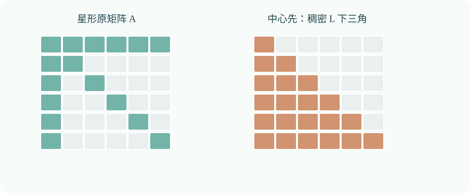

# 稀疏消元的秘密：输入很稀疏，因子为什么会变稠密

> 图邻接、CSR/CSC、填充与消元重排序的可验证反例

一个网络通常只连接少数邻居，矩阵里会出现大量零。直接求解时，每次消去变量可能在剩余变量之间制造新的耦合，这就是 fill-in。算法成本由输入的 nnz 与消元顺序共同决定，而不只是看原始矩阵有多少个零。



## 把对称非零图看成消元网络

对称矩阵可视为图：节点 i 对应未知量 xᵢ，aᵢⱼ≠0 就有一条边。取星形图拉普拉斯 L，再构造 A=I+L；xᵀAx=||x||²+Σ边(xᵢ−xⱼ)²>0，因此 A 对称正定，可使用 Cholesky。

对称置换 PᵀAP 只改变节点编号，不改变特征值，也不改变原问题的内容（还原变量排列即可）。但行列顺序会影响消元中生成哪些新非零元。

## CSR 不是简单地删除零

CSR 包含 data、indices、indptr 三条数组，分别保存结构非零数值、相应列索引、各行起止位置。n 行对应 indptr 长度 n+1；CSC 按列组织，便于许多稀疏直接法的列处理。

若同一坐标有多个数据项，构造矩阵时需要规范合并；显式保存的浮点零仍可能消耗稀疏格式空间。稀疏乘法与稀疏 LU 的结构需求也不同。

$$
A=I+L_{\mathrm{star}},\quad x^TAx=\|x\|^2+\sum_{(i,j)\in E}(x_i-x_j)^2
$$

## 星形图上两种顺序的鲜明差别

星形图的中心与各叶节点相连，但叶节点彼此无边。如果中心在第一步被消去，Schur 补会在所有叶节点之间引入填充，Cholesky 的下三角因子因此更稠密。

若先依次消去叶节点，再处理中心，每个叶子只连接剩下的中心，不产生叶叶填充。配套程序计算同一个 SPD 矩阵在两种顺序下的 Cholesky 严格下三角非零个数，用容差处理浮点结构零。

## 减少填充与选数值主元不是一回事

近似最小度和嵌套剖分尝试降低填充；一般稀疏 LU 还需要为数值稳定性考虑主元。这两个目标可能相互牵制，不能把结构排序误解为“选绝对值最小的矩阵元素”。

SciPy 的 splu 支持 COLAMD 等列重排序，SuperLU 还可能采用数值行交换。大型案例需要同时报告非零元数、内存峰值、重排成本和误差。

## 原矩阵 O(n) 非零不意味着因子 O(n)

二维及三维网格可能有 O(n) 结构非零元，消元时仍可能产生超线性填充。若只是计算 A@x，根本不需要形成因子；对于非常大的稀疏系统可评估迭代 Krylov 方法与预条件器。

交互图通过切换中心优先/最后的排序重绘输入 A 与因子 L 的图案，直接显示多出来的填充。该小图是反例，不是对通用排序算法的最佳性承诺。

## 数值交互与代码

中心节点连着所有叶子，为什么先消去中心会把叶子两两相连？

`消元顺序：0=中心先，1=中心最后`；图由数学模型驱动，不代表实测性能。

```bash
python "2_Linear_Equation_Solving/2.7_Special_Linear_Systems/03_2.7.4_General_Sparse_Matrices.py"
```

同目录 .m 为 MATLAB 版本。程序断言与反例详见 tests/test_chapter23_next.py。

## 参考来源

- [Demmel §2.7.4](https://doi.org/10.1137/1.9781611971446)
- [SciPy splu + COLAMD](https://docs.scipy.org/doc/scipy/reference/generated/scipy.sparse.linalg.splu.html)
- [Davis, Direct Methods for Sparse Linear Systems](https://doi.org/10.1137/1.9780898718881)
