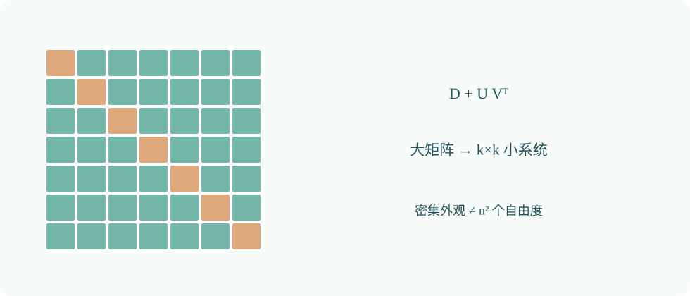

# 结构化稠密矩阵：元素全非零，为什么仍只需少量参数

> Toeplitz 自由度、D+UVᵀ 低秩更新与 Woodbury 小系统

n×n 矩阵可以看上去每个元素都非零，但信息维数远小于 n²。Toeplitz 矩阵按位移相同的对角线复用参数；D+UVᵀ 用对角阵和两个 n×k 窄矩阵生成整个稠密阵。当 k≪n 时，求解可能不用展开大矩阵。



## 稠密结构不等于 n² 个独立自由度

Toeplitz Tᵢⱼ=t_(i−j) 只使用 2n−1 个标量，却可在 n×n 所有位置非零；Toeplitz 并不必然低秩。另一个独立家族是 A=D+UVᵀ，其中 D 为对角阵，U、V 为 n×k。

存储 D 与两个窄因子需要 n+2nk 个值。若 k 足够小且右端项多，能够反复利用这一表示；对于很小 n、k 接近 n 或中间量巨大，直接分解可能反而更合适。

## Woodbury 推导：n×n 变成 k×k

记 z=D⁻¹b，W=D⁻¹U，K=I+VᵀW。若 D 和 K 都可逆，代入可得 x=z−W K⁻¹Vᵀz。实际代码首先求解 Kc=Vᵀz，最后更新 x=z−Wc；应使用求解操作，不需要形成逆矩阵。

若 D 是对角阵，求 z 和 W 只是按行除以对角元；形成 K 约 O(nk²)，解 k×k 系统约 O(k³)，回代 O(nk)。这些成本只在 k≪n 且结构真实存在时有意义。

$$
x=z-W(I+V^TW)^{-1}V^Tz,\qquad z=D^{-1}b
$$

## 用四阶秩一更新手算完整结果

取 D=I₄、U=V=1=[1,1,1,1]ᵀ，则 A=I₄+11ᵀ，主对角元素都是 2、其余是 1。此时 K=1+4=5。令 b=[1,0,0,0]ᵀ，z=b、Vᵀz=1，故 x=b−(1/5)1=[0.8,−0.2,−0.2,−0.2]ᵀ。

验证 1ᵀx=0.2，Ax=x+0.2·1=b。低秩更新会改变所有矩阵位置，但对求解过程只额外引入一次标量方程，这是本例与普通稠密矩阵的根本区别。

## 代数恒等式不是浮点稳定性保证

如果 D 很病态，z 与 W 中可能出现巨大的中间数，即使最终 A 不病态也可能严重抵消；K 若接近奇异，问题会在小系统中显现条件风险。Woodbury 的等式成立并不意味着所有浮点输入都数值可靠。

程序检查 D 的非零对角、K 的可解性，并用原始矩阵残差和 numpy.linalg.solve 结果交叉验证；无法保证时须改用合适的稳定分解，不能硬称结构表示总能加速。

## 动态参数图显示信息量而不是速度

网页固定 n=12，滑动 k，展示全非零的 A 网格以及 n+2nk 与 n² 的参数量对比。改变 k 会让生成参数量增加，但图中的矩阵仍可以处处非零。

测试覆盖秩一手算、多个 k、矩阵维度错误以及 Woodbury 解的原始残差。Toeplitz 的快速求解属于另一系列算法，不应把它与 Woodbury 混成同一种实现。

## 数值交互与代码

4×4 全非零的 I+11ᵀ 为什么能通过一个标量方程求解？

交互参数：12×12 中低秩因子的列数 k。网页图表由模型计算，不是硬件性能实测。

```bash
python "2_Linear_Equation_Solving/2.7_Special_Linear_Systems/04_2.7.5_Dense_Matrices_Depending_on_Fewer_Than_O(n²)_Parameters.py"
```

MATLAB 对照位于同路径的 .m 文件，测试位于 tests/test_chapter23_next.py。

## 参考来源

- [Demmel §2.7.5](https://doi.org/10.1137/1.9781611971446)
- [LinearSolve Woodbury method](https://docs.sciml.ai/LinearSolve/stable/tutorials/low_rank_updates/)
- [Berkeley numerical linear algebra notes](https://stat243.berkeley.edu/fall-2024/units/unit10-linalg.html)
