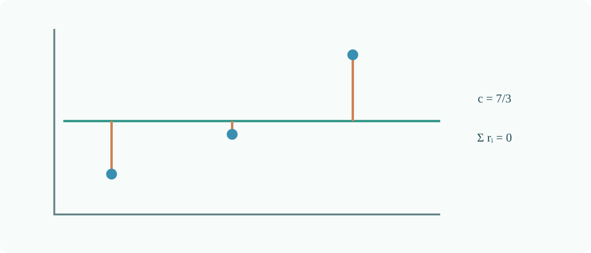

# 最小二乘的几何原理：让数据落到模型的列空间

> 超定观测、正交残差、唯一投影与最佳拟合的完整推导

有 m 个观测和 n 个未知参数，m>n 时通常无法满足全部 Ax=b 方程。最小二乘选择 x̂ 使 ||Ax̂−b||₂ 最小；几何上，p=Ax̂ 是 b 在 A 的列空间里的正交投影，剩余 r=b−p 与所有模型列向量垂直。



## 正交条件由方向导数自然出现

令 f(x)=½||Ax−b||₂²。沿方向 h 的变化率为 hᵀAᵀ(Ax−b)。要让它对所有 h 为零，必须 Aᵀ(Ax̂−b)=0，所以残差 r=b−Ax̂ 垂直于 Col(A)。

如果 A 列满秩，这个驻点是唯一最小点。若 A 秩亏，投影 p 仍唯一，但解参数 x 可能不唯一；这时可以额外选择二范数最小的那个 x。

## 三点常数拟合的完整手算

取 A=[1,1,1]ᵀ、b=[1,2,4]ᵀ、未知常数 c。代价 (c−1)²+(c−2)²+(c−4)² 的导数为 2(3c−7)，所以 c=7/3。

最佳预测 p=[7/3,7/3,7/3]ᵀ；残差 r=b−p=[−4/3,−1/3,5/3]ᵀ。三项相加正好为零，因此 Aᵀr=0，即使 r 并非零向量。

$$
A^T(b-A\hat x)=0,\qquad b=A\hat x+r
$$

## 空间分解与勾股定理

由于 p⊥r，且 b=p+r，因此 ||b||₂²=||p||₂²+||r||₂²。对任意另一组模型参数，p' 仍在 Col(A) 中，可用勾股定理证明 ||b−p'||₂²=||r||₂²+||p−p'||₂²≥||r||₂²。

把 r 称为“未由这个线性模型解释的部分”是准确的；不加统计假设就称它为独立白噪声则不准确。异常值、模型错设、测量偏置也都进入残差。

## 正规方程、QR、SVD 三条数值路线

正规方程 AᵀAx=Aᵀb 直接描述正交条件，但当矩阵列接近相关时，AᵀA 的条件数比 A 大得多；QR 用正交变换和三角求解避免显式形成 Gram 矩阵。

SVD 通过 σᵢ 揭示弱方向与秩亏时的最小范数解；对于超大稀疏问题，LSQR/LSMR 等迭代法可能比形成分解更节省内存。方法选择还取决于误差预算和结构。

## 滑动一个观测后重新拟合，而不是移动装饰线

浏览器固定前两点 b₁=1、b₂=2，滑动 b₃，每次重算 c=(3+b₃)/3，并绘制观测点、拟合线和各点竖直残差；同时显示残差平方和与 Σrᵢ。

Python/MATLAB 将手算 c 与 lstsq 结果比较，再验证 Aᵀr≈0 这一几何不变量，明确区别最小二乘最优与每个原方程均成立。

## 数值交互与代码

用一个常数拟合 [1,2,4]，为什么最优值是 7/3？

交互参数：第三个观测的数值 b₃。网页图表由模型计算，不是硬件性能实测。

```bash
python "3_Linear_Least_Squares_Problems/00_3.1_Introduction.py"
```

MATLAB 对照位于同路径的 .m 文件，测试位于 tests/test_chapter23_next.py。

## 参考来源

- [Demmel §3.1](https://doi.org/10.1137/1.9781611971446)
- [NumPy lstsq API](https://numpy.org/doc/stable/reference/generated/numpy.linalg.lstsq.html)
- [LAPACK DGELS](https://www.netlib.org/lapack/explore-html/d8/d83/group__gels_gaa65298f8ef218a625e40d0da3c95803c.html)
