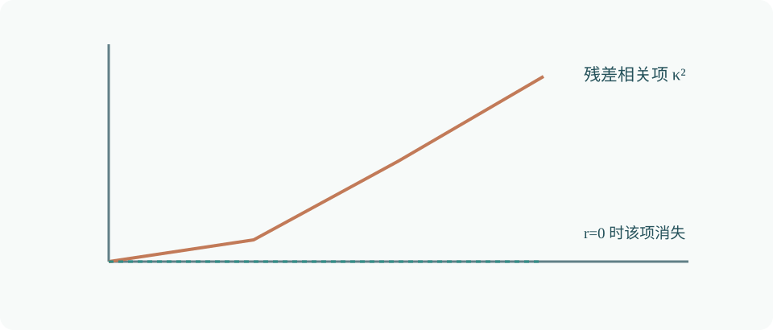

# 最小二乘扰动理论：为什么非零残差会再引入一个 κ² 放大项

> 求导正规方程、区分 Δb 与 ΔA、建立残差相关的一阶敏感性

最小二乘的数值困难不只是 A 的条件数。若 b 恰好在 A 的列空间中，矩阵扰动的行为接近普通线性系统；若已有非零的正交残差，微小 ΔA 会同时改变模型的列空间和它对 b 的投影方向。这一额外效应在扰动公式中经 (AᵀA)⁻¹ΔAᵀr 出现。



## 从最小二乘最优性而非错误矩阵逆开始

假设 A∈R^(m×n)、m≥n 且列满秩，x 是 min||Ax−b|| 的唯一解，定义 r=b−Ax。满足 Aᵀr=0。原始的 A 不是方阵，不能写成 (AᵀA)⁻¹Aᵀ 的“矩阵求逆”后再把 A+ΔA 的转置与逆错误排列。

当 b 变化 Δb 而 A 固定时，Δx=A†Δb，这个关系是精确的；因此 ||Δx||₂≤||A†||₂||Δb||₂=||Δb||₂/σ_min(A)。没有残差相关的二次条件数项。

## 对 A 与 b 同时扰动的一阶求导

令 F(A,x,b)=Aᵀ(Ax−b)=0。计算微分并令 dF=0：AᵀA·dx=Aᵀdb−Aᵀ(dA)x+(dA)ᵀr。第三项来自原始残差 r，它不会在 r=0 的一致系统中出现。

该式只是一阶导数，要求 A 保持满列秩、扰动足够小且可忽略二阶项。若 A+ΔA 秩发生变化，或 x 恰好为零导致相对误差无定义，不能机械套用一个相对条件数公式。

$$
A^TA\,dx=A^Tdb-A^T(dA)x+(dA)^Tr
$$

## 用 3×2 例子隔离残差效应

取 A=[[1,0],[0,δ],[0,0]]，δ=0.01；对 b₀=[1,δ,0]、b₁=[1,δ,1]，最小二乘解均为 x=[1,1]，但 b₀ 的残差为 0，b₁ 的残差为 [0,0,1]。

令 ΔA 仅在第三行第二列为 ε=10⁻⁶。新第二参数等于 x₂=(δ²+εb₃)/(δ²+ε²)。对 b₀ 的变化约 −10⁻⁸；对 b₁ 的变化约 +0.01。相同 A 和同样的矩阵扰动，仅因原始残差不同，响应相差约百万倍。

## 为什么会出现 κ² 而不是单一 κ

A† 的范数为 1/σ_min，矩阵扰动项 −A†(dA)x 典型地携带一次逆奇异值尺度；而残差项 (AᵀA)⁻¹(dA)ᵀr 可能携带 1/σ_min²。将它与 ||dA||、||r|| 和 x 的尺度相结合，就出现常见的 κ² 与残差角度因子。

这表示问题本身敏感，并非某一算法“做坏了”。使用 QR/SVD 可以降低算法自身的向后误差，但不能消除测量数据在弱方向上的客观不确定性。

## 误差界的前提比公式外形更重要

常见相对扰动界需说明 A 满列秩、b 与 x 非零、扰动足够小、残差夹角和范数约定。若 θ 接近 90°，p=Ax 变小，相对解误差即使在 κ(A) 不大时也会受放大；不应把绝对界直接替换成相对界。

交互图固定 δ=0.01，调整 b₃（也即垂直残差大小），并按精确 3×2 求解公式重算 x₂。程序同时用有限差分与一阶导数 εb₃/δ² 对照，验证线性模型适用域而不伪称二阶误差为零。

## 可调可视化与实验

同一个 A 和同样大小的 ΔA，为何仅仅改变正交残差就能把参数变化放大很多？

滑块：原始正交残差的第三分量 b₃，输出按参数重新计算；这不是硬件基准测试或保证性误差界。

```bash
python "3_Linear_Least_Squares_Problems/02_3.3_Perturbation_Theory_for_the_Least_Squares_Problem.py"
```

MATLAB 对照代码与 Python 数值断言分别提供，实际执行状态以测试记录为准。

## 参考来源

- [Demmel §3.3 least squares perturbation theory](https://doi.org/10.1137/1.9781611971446)
- [Higham, Accuracy and Stability of Numerical Algorithms](https://doi.org/10.1137/1.9780898718027)
- [NumPy least squares semantics](https://numpy.org/doc/stable/reference/generated/numpy.linalg.lstsq.html)
