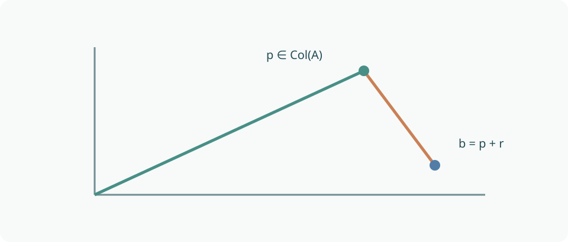

# QR 分解：用正交变换而不是条件数平方来求最小二乘

> 薄 QR 的形状、正交投影、Householder 与稳定性边界

QR 将 m×n 满列秩矩阵写为 A=QR，其中 Q∈R^(m×n) 满足 QᵀQ=I，R∈R^(n×n) 为可逆上三角。Q 的列空间与 A 一致，但 Q 的列彼此正交；目标因此分成可拟合的坐标和无法拟合的残差。求解 Rx=Qᵀb 无需形成 Gram 矩阵。



## 薄 QR 的矩阵形状有精确定义

当 m≥n、A 满列秩时，经济 QR 产生 Q 的形状 (m,n)，R 的形状 (n,n)，其中 QᵀQ=Iₙ 而通常 QQᵀ≠Iₘ。若使用完整 QR，Q_full 是 (m,m) 方阵，R_full 是 (m,n)，两种接口都合法，但不能混写尺寸。

Qᵀ 只截取 b 在模型列空间的正交坐标，故最小化 ||QRx−b|| 等价于选择 x 使 Rx=Qᵀb，然后留下 Q 的正交补方向的残差。

## 正交分解把残差平方和分成两块

定义 p=QQᵀb、r=b−p。因 Qᵀr=0，||Ax−b||²=||Rx−Qᵀb||²+||r||²，后项与 x 无关。列满秩时通过回代解 Rx=Qᵀb 后第一项归零，得到最优参数。

这种拆分在数学上完全等价于正规方程，但计算时不需要先乘 AᵀA；Householder 正交变换保持二范数，通常比显式构造 Gram 更稳健。

$$
A=QR,\quad Q^TQ=I,\quad Rx=Q^Tb
$$

## 一个有斜率的三点拟合

取 A=[[1,0],[1,1],[1,2]]，b=[1,2,2]。模型为 bᵢ≈c+txᵢ，均值 x 为 1、均值 b 为 5/3，斜率 t=1/2，截距 c=7/6。

代回得到预测 [7/6,5/3,13/6]，残差 b−Ax̂=[−1/6,1/3,−1/6]，验证残差和与 x 加权残差和都为零；这与 Qᵀr=0 等价。

## Householder 与经典 Gram–Schmidt 不是同一种数值稳定性

Householder 反射 P=I−2vvᵀ/(vᵀv) 逐列消去下方元素，数值上更易维持近似正交性。经典 Gram–Schmidt 在列高度相关时可能失去正交；改进 Gram–Schmidt 与重正交可改善，但也应区分具体实现。

QR 分解通常需要 O(mn²) 运算；当矩阵秩亏或严重近秩亏时，R 的小对角可能导致病态求解，需列主元 QR、SVD 或正则化，而不能声称无主元薄 QR 总是解决全部数值风险。

## 用交互模型直接看投影和残差

网页固定二维平面中的列空间方向，滑块改变 b 在正交方向上的分量，动态画出 b、p 与 r。滑块改变时 p 不变而垂直残差增长，直观说明何者能被模型拟合。

Python/MATLAB 计算经济 QR，验证 QᵀQ≈I、QR≈A、Qᵀ(b−Ax̂)≈0 和原问题残差；实验还报告矩阵尺寸，防止错误使用完整 QR 的形状假设。

## 可调可视化与实验

为什么 Qᵀb 只需 n 个数，却能得到 m 个观测的最优拟合？

滑块：正交残差长度 r⊥（水平投影 p=3 不变），模型结果按参数重新计算。数学模型不意味着某种固定硬件的性能实测。

```bash
python "3_Linear_Least_Squares_Problems/3.2_Matrix_Factorizations_That_Solve_the_Linear_Least_Squares_Problem/01_3.2.2_QR_Decomposition.py"
```

同名 MATLAB 代码与 Python 回归测试互相核对，不宣称 MATLAB 已在当前环境执行。

## 参考来源

- [Demmel §3.2.2](https://doi.org/10.1137/1.9781611971446)
- [NumPy QR reduced mode](https://numpy.org/doc/stable/reference/generated/numpy.linalg.qr.html)
- [LAPACK DGELS](https://www.netlib.org/lapack/explore-html/d8/d83/group__gels_gaa65298f8ef218a625e40d0da3c95803c.html)
