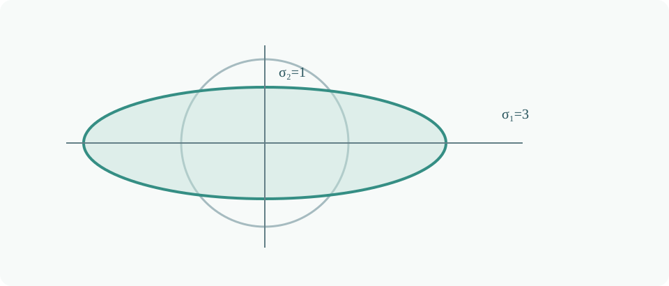

# SVD 最小二乘：哪些方向能够辨认，哪些方向只能放弃

> 奇异值、单位圆映射、最小范数解与截断阈值的数学代价

SVD 将 A 分解为 UΣVᵀ，把一般线性映射拆成两个正交旋转与沿相互垂直方向的尺度变化。在最小二乘中，σᵢ 很小时，需要除以它才能恢复对应参数，于是数据误差可能被放大。若 σᵢ=0，解不唯一，但可以沿零空间选择最小范数解。



## 从单位球到椭球看奇异值

对任意实矩阵 A∈R^(m×n)，存在 A=UΣVᵀ，奇异值非负并可降序排列。V 的单位向量先确定输入方向，Σ 沿主轴按 σᵢ 拉伸或压缩，再由 U 定向输出。

在二维例子 A=diag(3,σ₂) 中单位圆映射成半长轴 3、半短轴 σ₂ 的椭圆。若 σ₂→0，沿第二输入方向的变化几乎不影响输出；若 σ₂=0，该方向进入零空间，无法由数据唯一恢复。

## 伪逆从最小二乘与最小范数两个条件得出

对非零 σᵢ，左奇异方向上的数据系数 uᵢᵀb 需除以 σᵢ，得到 x̂=Σ_(σᵢ>0) vᵢ(uᵢᵀb/σᵢ)。在零奇异值对应的右奇异方向上加任意向量，都不改变 Ax；将这些自由分量设为零可得到二范数最小的最小二乘解。

浮点计算必须定义数值秩的阈值，实际采用 σᵢ>τ·σ_max 之类规则。阈值并非纯数学事实，可能将很小但非零的奇异值视为零，从而引入偏差换取更好的误差放大控制。

$$
A=U\Sigma V^T,\quad x_{\min}=\sum_{\sigma_i>\tau}v_i\,\frac{u_i^Tb}{\sigma_i}
$$

## 秩一三行两列矩阵的完整反例

令 A=[[1,1],[2,2],[3,3]]、b=[1,2,3]，方程等价于 x₁+x₂=1。任意 [t,1−t] 都满足 Ax=b，其中范数最小的是 t=1/2，因此 x̂=[0.5,0.5]。

A 的零空间由 [1,−1] 方向张成。最小范数解在这个方向的投影为零；使用 np.linalg.lstsq 或显式带阈值 SVD 均可重构该结果。直接形成 AᵀA 则会得到奇异矩阵，不可当作常规 SPD 求解。

## 噪声、截断和偏差的交换

假设真实 σ₂ 很小，b 在相应左奇异方向上的扰动 ε 可能导致 x₂ 变化 ε/σ₂。保留该方向会提高无偏拟合能力，却可能使估计极不稳定；截断奇异值让这项不再放大，但会丢失真实参数分量。

因此“使用 SVD”不代表不需决定秩，也不能声称通过截断便恢复了未知真实信号。可信工作流应同时报告奇异值谱、阈值、残差、数值秩和解范数。

## 交互椭圆为何比三个名字更能解释 SVD

网页让 σ₂ 在 0.1–3 之间变化，固定 σ₁=3；实时绘制映射后的椭圆，并计算 κ₂=3/σ₂。随着 σ₂ 缩小，椭圆被压扁，逆问题的放大风险增加。

Python/MATLAB 对不同秩矩阵执行 SVD，并检验 A≈UΣVᵀ、最小范数解和残差。演示中截断阈值与真实有限精度求解器的默认行为必须区分。

## 可调可视化与实验

A 的两列完全相同，为什么最小范数解是 [0.5,0.5] 而非 [1,0]？

滑块：椭圆次轴 σ₂（主轴 σ₁=3），输出按参数重新计算；这不是硬件基准测试或保证性误差界。

```bash
python "3_Linear_Least_Squares_Problems/3.2_Matrix_Factorizations_That_Solve_the_Linear_Least_Squares_Problem/02_3.2.3_Singular_Value_Decomposition.py"
```

MATLAB 对照代码与 Python 数值断言分别提供，实际执行状态以测试记录为准。

## 参考来源

- [Demmel §3.2.3](https://doi.org/10.1137/1.9781611971446)
- [LAPACK DGELSD SVD minimum norm least squares](https://netlib.org/lapack/explore-html/db/d6a/dgelsd_8f_source.html)
- [NumPy lstsq singular value cutoff](https://numpy.org/doc/stable/reference/generated/numpy.linalg.lstsq.html)
